# Premium HRM — User Guide

**Attendance · Rosters · Leave · Approvals · Payroll · Self-service**

| | |
|---|---|
| **Product version** | 1.0 |
| **Guide revision** | October 2026 |
| **Audience** | System administrators, HR and payroll teams, managers and employees |
| **Editions** | On-premises and Cloud (identical features) |

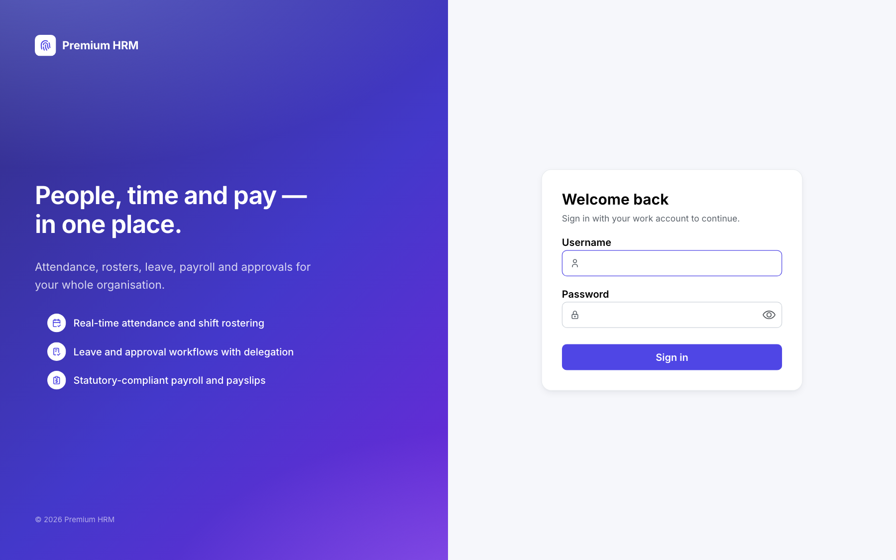

---

## How to use this guide

This guide takes you from a brand-new installation to running a full monthly payroll. Read it in order the
first time — each chapter builds on the data created in the previous one — and use it as a reference later.

| If you are… | Start with |
|---|---|
| The IT administrator installing the system | [2. Installation](#2-installation) |
| The person setting the system up for your organisation | [3. Getting started](#3-getting-started) and [4. Setup checklist](#4-setup-checklist) |
| An HR officer | [7. Employees](#7-employees), [11. Leave management](#11-leave-management) |
| A payroll officer | [13. Payroll](#13-payroll) |
| A manager or supervisor | [12. Approvals](#12-approvals), [9. Attendance](#9-attendance) |
| An employee | [15. My Portal — employee self-service](#15-my-portal--employee-self-service) |

**Conventions**

- **Bold text** is something you click or type, for example **Organization Setup → Branches → Create branch**.
  The arrow (→) separates the menu item, the tab and the button.
- Numbered red markers on the screenshots match the numbered steps in the text next to them.
- Notes, tips and warnings are shown like this:

> [!NOTE]
> Extra information that helps you understand a feature.

> [!TIP]
> A shortcut or a good practice.

> [!WARNING]
> Something that cannot be undone or that affects pay. Read it before you continue.

**About the screenshots.** The screenshots show a fictional company, *ACME Holdings (Pvt) Ltd*, with twelve
employees in Colombo and Kandy. Names, numbers and amounts are sample data. Your screens show your own data,
and you see only the menus that your role allows.

---

## 1. Introduction

### 1.1 What Premium HRM does

Premium HRM is a web-based human-resource system for organisations with one or more companies, branches
and departments. It covers the full cycle from hiring to payslip:

| Module | What you can do |
|---|---|
| **Organization Setup** | Companies, branches, department hierarchy, designations, grades, employment categories, holidays, custom employee fields and company-wide rules |
| **Employee Hub** | Employee master records, documents, employment history (transfers, promotions, exits) and salary structures |
| **Attendance** | Collect punches from fingerprint/card devices or CSV files, calculate daily attendance (late, early, short, overtime), correct mistakes with an audit trail, approve overtime |
| **Shift & Roster** | Fixed, flexible, night and split shifts; overtime policies; rotating shift patterns; weekly and monthly rosters with publish, lock and revision history |
| **Leave Management** | Leave types and policies, balances, accrual, carry-forward, applications, a team calendar |
| **Approvals** | Multi-level approval workflows for leave, attendance corrections and payroll, with delegation |
| **Payroll** | Earnings, deductions and employer contributions; Sri Lankan EPF / ETF / APIT out of the box; monthly payroll runs with review, approval and finalization; payslips and exports |
| **Reports** | Ten standard reports on screen and as PDF, Excel or CSV, plus a live dashboard |
| **My Portal** | Employee self-service: profile, attendance, schedule, leave, payslips |
| **Administration** | Users, roles and permissions, data scope, and a tamper-proof audit log |

### 1.2 Key concepts

Understanding these ideas makes the rest of the guide easy.

**Installation, companies and the working company.** One installation can hold several companies (legal
entities). Most screens work on one company at a time — the *working company*, shown in the header. If you
have access to more than one company, pick the working company from the header switcher.

**Roles and permissions.** What a user may *do* is controlled by their roles. Each role is a set of
permissions such as `EMPLOYEE:EDIT` or `PAYROLL:APPROVE`. Nine roles are supplied (see
[Appendix B](#appendix-b--default-roles)), and you can create your own.

**Data scope.** *Whose records* a user may see is controlled separately by their data scope: all data,
selected companies, selected branches, selected departments (including sub-departments) or only their own
record. A department manager with a department scope sees only their team, even on reports.

**Approval workflows.** Leave requests, attendance corrections and payroll runs can require approval by one
to five levels of approvers — the reporting manager, anyone with a given role, or a named user. Approvers
can delegate their approvals while they are away.

**From punch to payslip.** The modules feed each other in this order:

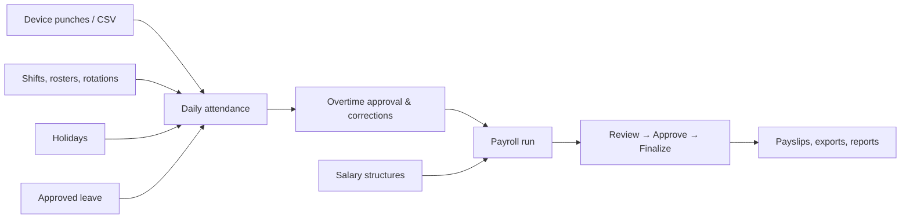

Every critical change on the way — a corrected punch, an approved leave, a changed salary, a finalized
payroll — is written to the audit log with the user, the time and the before/after values.

### 1.3 Supported browsers and devices

Premium HRM runs in any current version of Chrome, Edge, Firefox or Safari on Windows, macOS, Linux, Android
and iOS. Nothing has to be installed on users' computers. Every screen also works on a phone (from 360 px
wide), so employees can apply for leave or download payslips from their mobile.

---

## 2. Installation

*This chapter is for the IT administrator. If the system is already running, skip to
[3. Getting started](#3-getting-started).*

Premium HRM is delivered as Docker containers. On a Windows server without Docker, use the Windows installer
instead (see [2.6 Windows server](#26-windows-server)). The same Docker image is used for both editions:

| | On-premises | Cloud |
|---|---|---|
| Where it runs | A server in your own network | A virtual machine you or your provider manage |
| HTTPS certificate | Issued by the bundled internal certificate authority (or your own) | Public Let's Encrypt certificate, issued automatically |
| Compose file | `deploy/compose.onprem.yml` | `deploy/compose.cloud.yml` |

### 2.1 Requirements

- A Linux server (x86-64 or arm64) with **4 vCPU, 8 GB RAM and 50 GB disk** — enough to process payroll for
  1,000 employees in well under a minute.
- **Docker Engine 24 or later** with the Compose plugin (check with `docker compose version`).
- A host name your users can reach, for example `hrm.local` (on-premises) or `hr.yourcompany.com` (cloud).
- Ports **80 and 443** free on the server.
- Optional: an SMTP mail server, used to email payslips and approval notifications.

### 2.2 Configure

1. Copy the release bundle to the server, for example to `/opt/hrm`, and open that folder.
2. Create the configuration file from the template and protect it:

   ```bash
   cd /opt/hrm
   cp deploy/.env.example deploy/.env
   chmod 600 deploy/.env
   ```

3. Edit `deploy/.env` and set at least these values:

   | Setting | What to enter |
   |---|---|
   | `HRM_DB_PASSWORD` | A long random password, e.g. from `openssl rand -base64 24` |
   | `HRM_JWT_SECRET` | At least 32 random bytes, e.g. from `openssl rand -base64 48`. The system does not start without it. |
   | `HRM_ADMIN_USERNAME` / `HRM_ADMIN_PASSWORD` | The first administrator account. It is created only on an empty database and must change its password at first sign-in. |
   | `HRM_HOSTNAME` (on-premises) or `HRM_DOMAIN` + `HRM_ACME_EMAIL` (cloud) | The address users type in the browser |
   | `HRM_MAIL_ENABLED=true` and `HRM_SMTP_*` | Only if payslips and notifications should be emailed |
   | `TZ`, `HRM_BACKUP_AT`, `HRM_BACKUP_RETENTION_DAYS` | Time zone (used by the app and the backup schedule), backup time of day (default 02:00) and how many days to keep (default 14) |

> [!WARNING]
> Keep `deploy/.env` secret and keep a copy in a password manager. It is **not** included in backups, and you
> need it to restore the system on a new server.

### 2.3 Start the system

On-premises:

```bash
docker compose -f deploy/compose.onprem.yml up -d --build
docker compose -f deploy/compose.onprem.yml ps       # wait until "app" shows "healthy" (about a minute)
```

Cloud (prebuilt image set in `HRM_IMAGE`):

```bash
docker compose -f deploy/compose.cloud.yml pull
docker compose -f deploy/compose.cloud.yml up -d
```

Four services start: **app** (Premium HRM), **db** (PostgreSQL), **caddy** (HTTPS) and **backup** (daily
database and document backup).

### 2.4 Trust the certificate (on-premises only)

The on-premises bundle issues its own HTTPS certificate. Until client PCs trust it, browsers show a security
warning. Export the root certificate and distribute it as a *trusted root CA* through Group Policy, your MDM
tool or the macOS keychain:

```bash
docker compose -f deploy/compose.onprem.yml cp caddy:/data/caddy/pki/authorities/local/root.crt ./hrm-root.crt
```

If you already have a certificate from your company CA, use it instead — see `docs/install-onprem.md`.

### 2.5 Backups

Backups run automatically every day. Each backup set is a database dump and an archive of uploaded documents
in `deploy/backups/`. Copy that folder to another machine or to cloud storage every day, and practise a
restore at least once a quarter. Commands for a manual backup and for restoring are in
[Appendix F](#appendix-f--backup-and-restore-quick-reference) and `docs/backup-recovery.md`.

### 2.6 Windows server

On Windows Server 2019 or later (or Windows 10/11, 64-bit), run `PremiumHRM-Setup-<version>.exe` as
administrator. The wizard asks for four things:

- the data folder (default `C:\ProgramData\PremiumHRM`)
- the host name users type in the browser
- the HTTPS and HTTP ports (default 443 and 80)
- the first administrator's user name and password

Setup checks that the ports are free. If one is taken, it names the program that holds it, often IIS. It then
installs PostgreSQL and the application as Windows services, generates the secrets, and schedules the daily
backup. The web address opens when setup finishes.

Distribute `<data folder>\hrm-root.crt` to client PCs as a trusted root certificate, as in section 2.4. The
configuration, logs and backups are in the data folder. Details, including email settings, upgrades and
restores, are in `docs/install-windows.md`.

---

## 3. Getting started

### 3.1 Sign in

1. Open the address of your installation in the browser, for example `https://hrm.local`.
2. Enter your **Username** (1) and **Password** (2), then click **Sign in** (3).

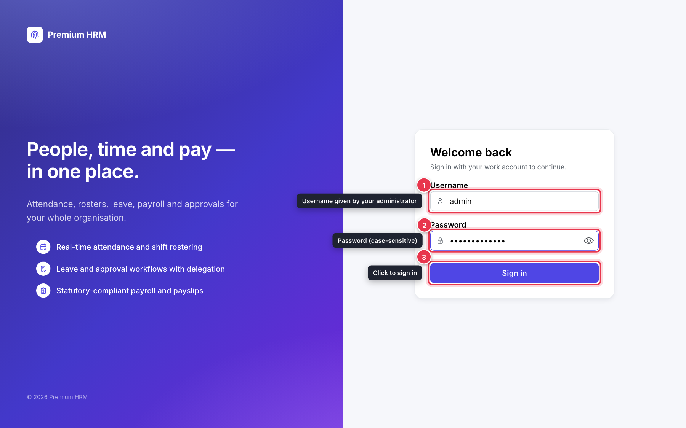

> [!NOTE]
> After five wrong passwords in a row, the account is locked for 15 minutes. The error message is the same
> whether the username or the password is wrong, so nobody can guess which usernames exist.

### 3.2 Change the temporary password

The first time you sign in — and whenever an administrator resets your password — you must choose a new one
before you can continue.

1. Enter the temporary password in **Current password** (1).
2. Enter a new password (2). It needs **at least 10 characters**, with **upper- and lower-case letters, a
   number and a symbol**. The checklist under the field turns green as each rule is met.
3. Type it again in **Confirm new password** (3) and click **Update password** (4).

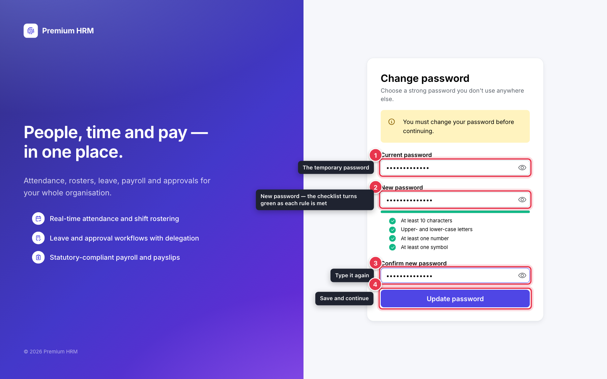

You can change your password at any time from the **user menu** (your name, top right) → **Change password**.

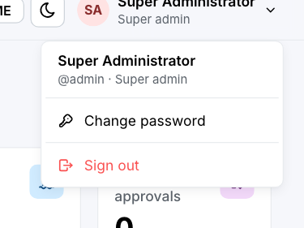

### 3.3 A tour of the workspace

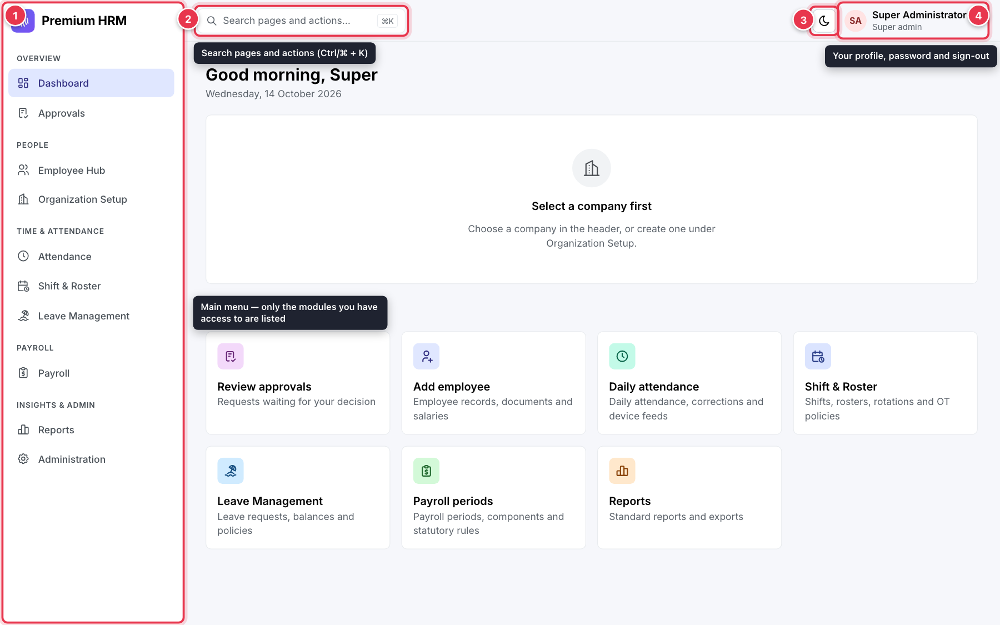

| # | Area | What it does |
|---|---|---|
| 1 | **Main menu** | The modules, grouped into *Overview*, *People*, *Time & attendance*, *Payroll* and *Insights & admin*. You see only the modules your role allows. The **Approvals** item shows a counter when requests are waiting for you. |
| 2 | **Search** | Opens the command palette (also **Ctrl + K** on Windows/Linux, **⌘ + K** on Mac) to jump to any page, action or employee. |
| 3 | **Light / dark mode** | Switches the colour theme. Your choice is remembered on this device. |
| 4 | **User menu** | Your name and role, **My Portal** (if your account is linked to an employee record), **Change password** and **Sign out**. |

After the first company is created, the header also shows the **working company** — a selector when you
have access to several companies, or a label when you have only one. The company's legal name, currency and
time zone are shown at the bottom of the menu.

**The command palette.** Press **Ctrl/⌘ + K** anywhere and start typing. You can open pages, run actions
such as *Add new employee* or *Toggle dark mode*, or type part of an employee's name or number to jump
straight to their record.

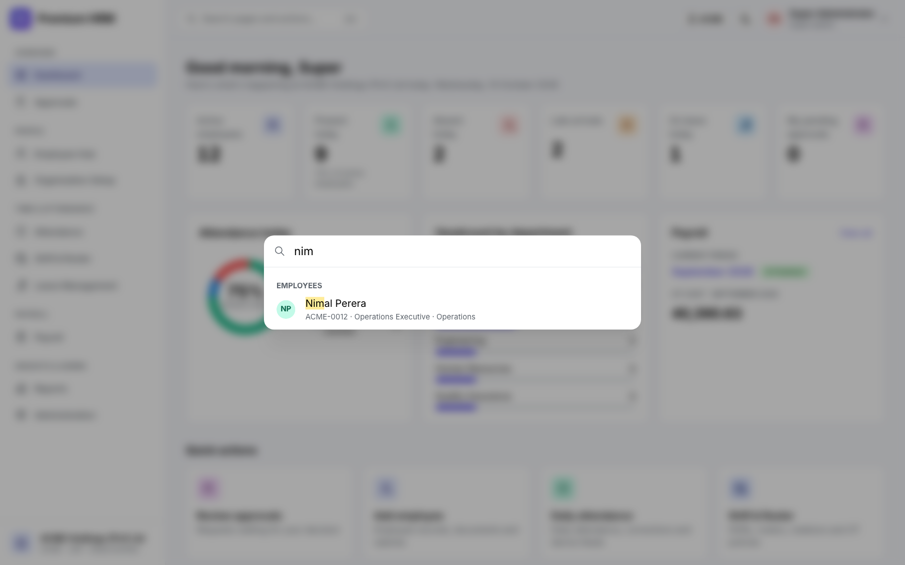

**On a phone**, the menu is behind the ☰ button at the top left.

<p class="pair">

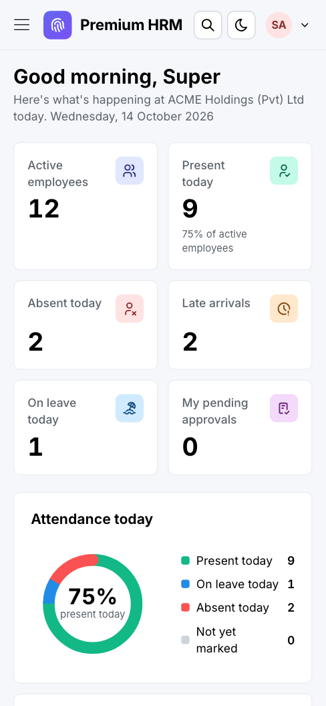
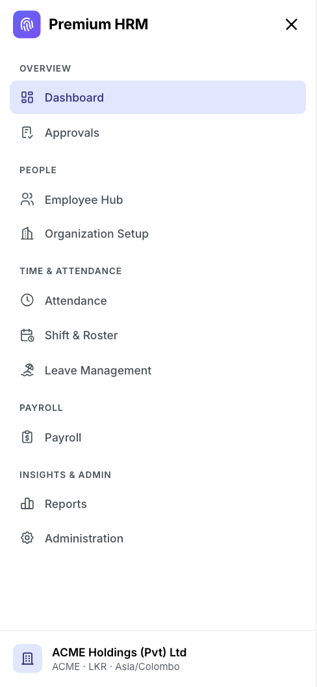

</p>

### 3.4 Common screen patterns

Once you know these patterns you can use every module:

- **Tabs** at the top of a page divide a module into sections (for example *Daily attendance*, *Exceptions*,
  *Import & devices*). The selected tab is part of the page address, so you can bookmark it.
- **Lists** show a loading placeholder while data loads and a friendly message with a next step when there is
  nothing to show. Long lists have a search box and page through 20–50 rows at a time.
- **Click a row** to open its details or edit it. Edit forms open in a panel on the right-hand side.
- **Required fields** are marked with a red asterisk (\*). If something is wrong, the message appears under
  the field.
- **Deleting** always asks for confirmation. Records that are in use (for example a branch with employees)
  cannot be deleted — deactivate them instead.
- **Status badges** use consistent colours: green for good/complete, yellow for pending, red for
  rejected/absent, dark for locked, grey for inactive.

---

## 4. Setup checklist

Follow these steps once, in this order, to take a new installation to its first payroll. Each step links to
the section that explains it. Most organisations finish the setup in a day.

| # | Step | Where | Section |
|---|---|---|---|
| 1 | Sign in and change the administrator password | Sign-in page | [3.1](#31-sign-in) |
| 2 | Create your company | Organization Setup → Companies | [5.1](#51-create-the-company) |
| 3 | Review the company settings (weekly off, numbering, payroll rules) | Organization Setup → Settings | [5.2](#52-company-settings) |
| 4 | Add branches, departments, designations, grades and employment categories | Organization Setup | [5.3](#53-branches) – [5.5](#55-designations-grades-and-employment-categories) |
| 5 | Load the year's holidays | Organization Setup → Holidays | [5.6](#56-holidays) |
| 6 | Create overtime policies and shifts | Shift & Roster | [6](#6-shifts-and-overtime-policies) |
| 7 | Add employees (with badge ID and default shift) | Employee Hub | [7](#7-employees) |
| 8 | Enter salary structures | Employee Hub → *employee* → Salary | [7.6](#76-salary-structure) |
| 9 | Create user accounts and link employees to them | Administration → Users | [8](#8-users-roles-and-permissions) |
| 10 | Connect attendance devices (or import a CSV) | Attendance → Import & devices | [9.1](#91-connect-attendance-devices) |
| 11 | Review leave types and approval workflows | Leave Management, Approvals | [11.1](#111-leave-types-and-policies), [12.5](#125-approval-workflows) |
| 12 | Run the first payroll | Payroll | [13.4](#134-the-monthly-payroll-run) |

> [!TIP]
> Creating a company also creates sensible defaults for you: company settings, four leave types (Annual,
> Casual, Medical, No pay), three approval workflows (the one for attendance corrections starts disabled) and — with the
> statutory pack `LK` — the full Sri Lankan payroll setup (EPF, ETF, APIT, overtime, no-pay, bonus and
> allowance components). You only need to review them.

---

## 5. Organization setup

**Organization Setup** holds the structure that everything else hangs on. The sections are listed on the
left: *Companies*, *Settings*, *Branches*, *Departments*, *Designations*, *Grades*, *Employment
categories*, *Holidays* and *Custom fields*. All sections except *Companies* work on the working company
shown in the header.

*Required permission:* `ORG:VIEW` to look, `ORG:ADD` / `ORG:EDIT` / `ORG:DELETE` to change, and
`ORG:CONFIGURE` to create companies, change settings and manage holidays. Custom fields need `EMPLOYEE:VIEW`
to see and `EMPLOYEE:CONFIGURE` to change.

### 5.1 Create the company

1. Open **Organization Setup → Companies** and click **Create company**.
2. Fill in the form on the right:

   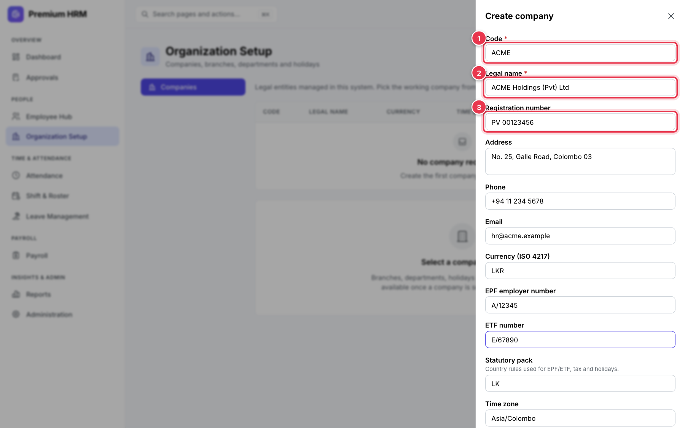

   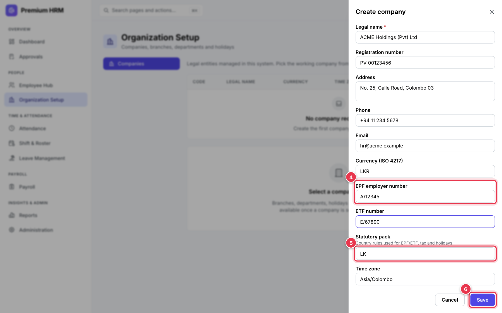

   | # | Field | Notes |
   |---|---|---|
   | 1 | **Code** | A short unique code such as `ACME`. It can be used in employee numbers, so keep it short. |
   | 2 | **Legal name** | The registered name. It is printed on payslips and reports. |
   | 3 | **Registration number**, address, phone, email | Optional company details. |
   | 4 | **EPF employer number**, **ETF number** | Your statutory registration numbers. |
   | 5 | **Statutory pack** | The country rules for statutory deductions. `LK` (Sri Lanka) sets up EPF 8 % / 12 %, ETF 3 % and APIT. **Currency (ISO 4217)** (default `LKR`) is further up and **Time zone** (default `Asia/Colombo`) just below. |
   | 6 | **Save** | Creates the company with all its defaults. |

3. The company appears in the list, marked **Current**. Its code is now shown in the header (2), and all
   setup sections appear on the left (1).

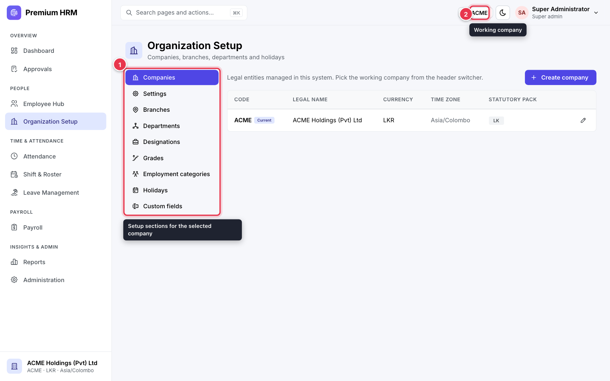

> [!NOTE]
> Only users whose data scope is *All data* can create companies. If you manage several companies, switch
> between them with the company selector in the header — every module follows the selected company.

### 5.2 Company settings

**Organization Setup → Settings** holds the rules that apply to the whole company. Review them before you add
employees.

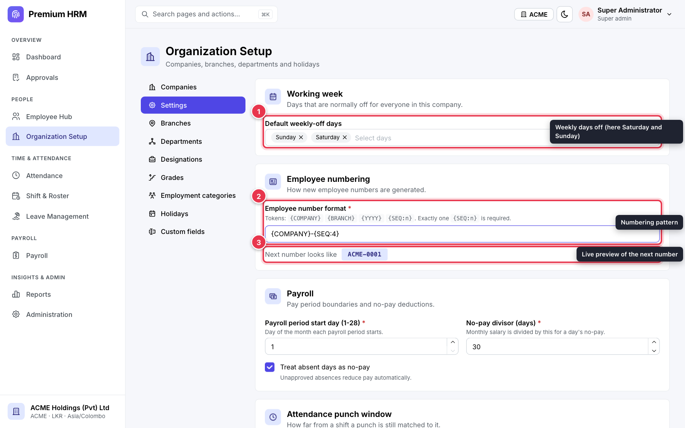

| # | Setting | What it controls |
|---|---|---|
| 1 | **Default weekly-off days** | The normal days off, for example Saturday and Sunday. Each employee can override this. |
| 2 | **Employee number format** | How new employee numbers are generated. Combine text with the tokens `{COMPANY}` (company code), `{BRANCH}` (branch code), `{YYYY}` (year of joining) and exactly one `{SEQ:n}` (a running number with *n* digits). |
| 3 | **Preview** | Shows what the next number looks like, for example `{COMPANY}-{SEQ:4}` → `ACME-0001`. |

Scroll down for the payroll and attendance rules:

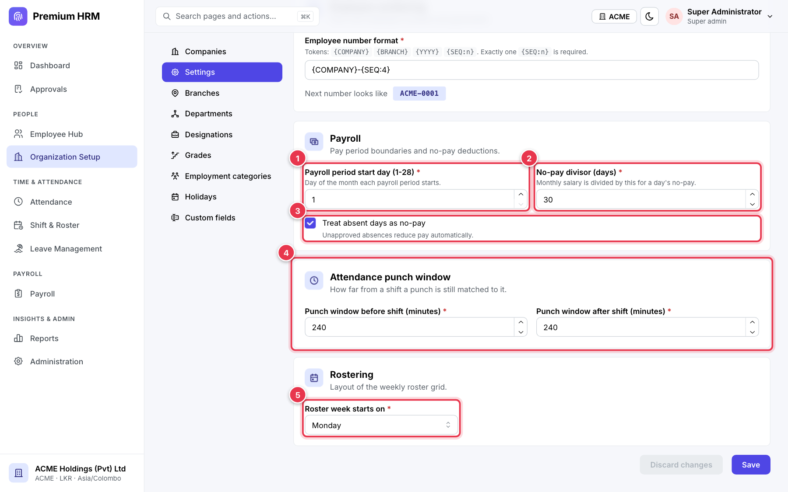

| # | Setting | What it controls |
|---|---|---|
| 1 | **Payroll period start day (1–28)** | The day each pay period starts. `1` means calendar months. `21` means 21st of the previous month to the 20th. |
| 2 | **No-pay divisor (days)** | A day's no-pay deduction is *basic salary ÷ divisor* (default 30). |
| 3 | **Treat absent days as no-pay** | When ticked, unexplained absences are deducted from pay automatically. |
| 4 | **Attendance punch window** | How many minutes before the start and after the end of a shift a punch still counts for that shift (default 240 / 240). |
| 5 | **Roster week starts on** | The first day of weekly rosters (default Monday). |

Click **Save** at the bottom. Changes apply to attendance and payroll calculated *after* the change; past
results are not recalculated until you process them again.

### 5.3 Branches

Branches are your physical locations — offices, factories, outlets.

1. Open **Organization Setup → Branches** and click **Create branch**.
2. Enter the **Code** (1) and **Name** (2), and optionally the address and phone, then click **Save** (3).

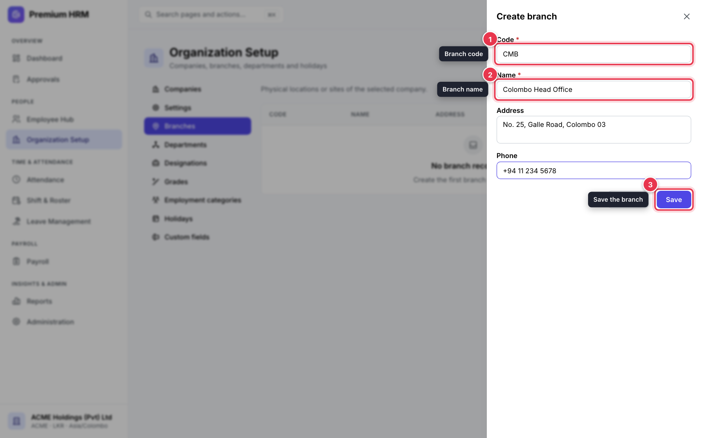

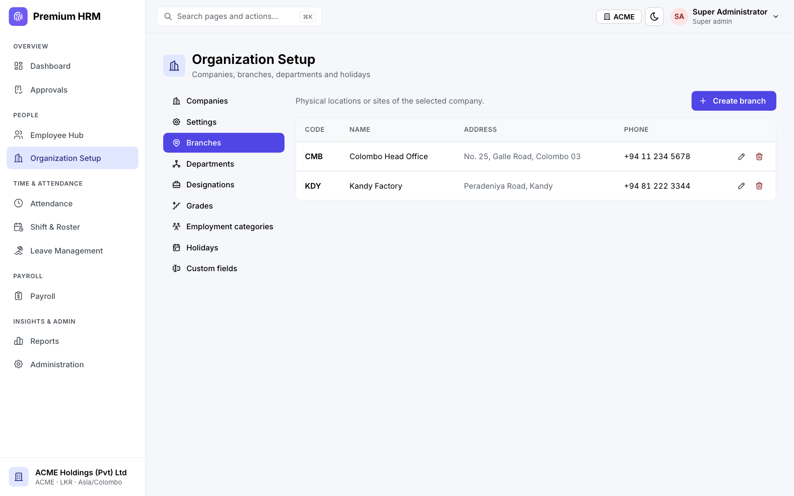

Click a row to edit a branch, or use the pencil and bin icons on the right. A branch that still has active
employees cannot be deleted.

### 5.4 Departments

Departments form a hierarchy: a department can have a parent, so *Software Development* and *Quality
Assurance* can sit under *Engineering*. Managers whose data scope is a department automatically see its
sub-departments as well.

1. Open **Organization Setup → Departments** and click **Create department**.
2. Enter the code and name. To place it under another department, choose the **Parent department** (1).
   Optionally restrict it to a branch and give it a **Cost center code** (2) for reporting.
3. Click **Save**.

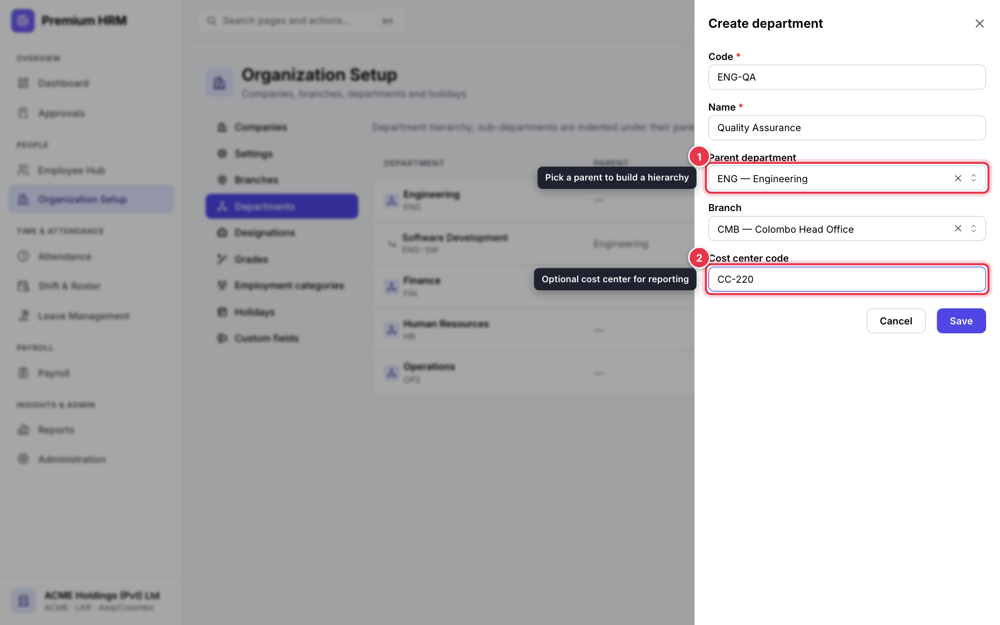

The list shows the hierarchy, with sub-departments indented under their parent:

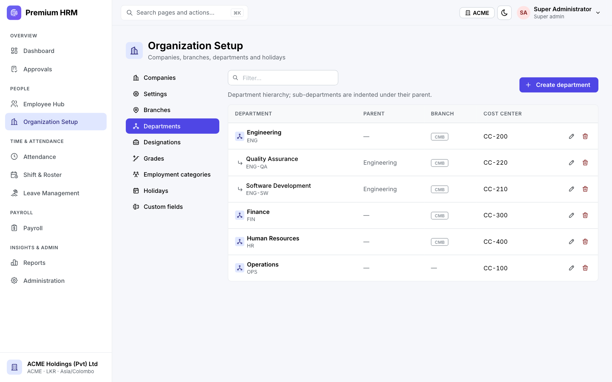

> [!NOTE]
> The system prevents loops (a department cannot be its own ancestor) and does not let you delete a department
> that still has employees or sub-departments.

### 5.5 Designations, grades and employment categories

These three lists describe each employee's job and terms. They work the same way: click **Create …**, enter a
code and a name, and click **Save**.

| List | Purpose | Example |
|---|---|---|
| **Designations** | Job titles | Software Engineer, Accountant, Machine Operator |
| **Grades** | Pay or seniority levels; the **Rank** sets the order in which they are listed | E1 Entry, S1 Staff, S2 Senior Staff, M1 Manager |
| **Employment categories** | Type of employment and whether it earns overtime | Permanent, Contract, Executive |

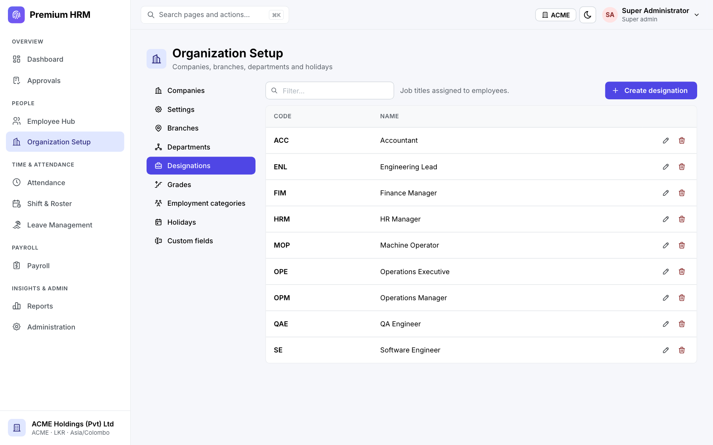

On **Employment categories**, the **Eligible for overtime** setting matters for pay. For employees in a
category that is not eligible (1), extra time worked is recorded as *extra hours* and paid at the *Extra
hours* rate (×1.0 by default), not at overtime rates.

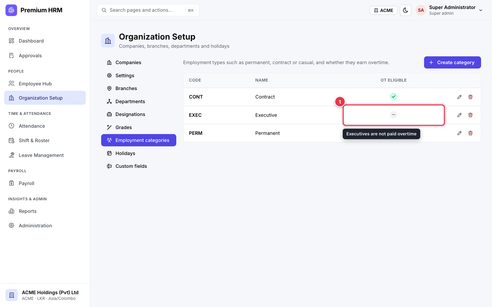

### 5.6 Holidays

Holidays affect attendance (nobody is marked absent), leave (holidays inside a leave are usually not
counted) and payroll (work on a holiday is paid at the holiday overtime rate).

1. Open **Organization Setup → Holidays**. Use the arrows or the **Year** box to pick the year.
2. Click **Create holiday** (2). Enter the **Date**, **Name** and **Type** (*Public*, *Mercantile*,
   *Company* or *Other*). Leave **All branches** ticked, or untick it and choose the branches it applies to.
3. Click **Save**.

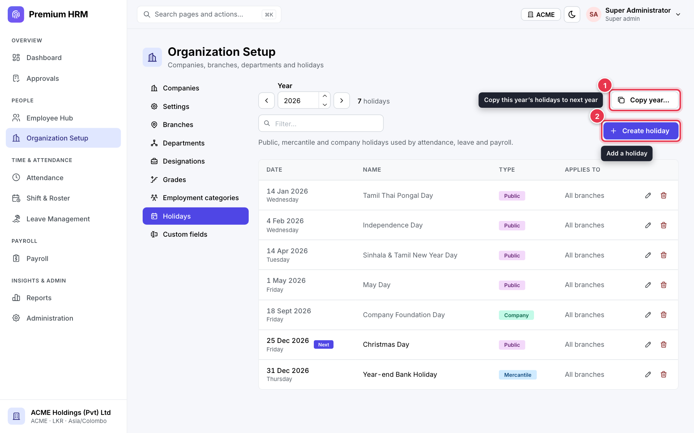

The next upcoming holiday is marked **Next**. To prepare next year quickly, click **Copy year…** (1), enter
the target year and click **Copy**. Dates are kept by day and month, and dates that already exist are skipped.
Then adjust the moving holidays (such as Poya days) by hand.

### 5.7 Custom employee fields

If you need to record something about every employee that the standard form does not have — a blood group, a
uniform size, a union membership — add a custom field.

1. Open **Organization Setup → Custom fields** and click **Create custom field**.
2. Enter a **Key** (1) — an internal name with lower-case letters, digits and underscores, such as
   `blood_group`. It cannot be changed later.
3. Enter the **Label** that users see, and choose the **Type** (2): *Text*, *Number*, *Date*, *Yes / no* or
   *Dropdown list*. For a dropdown, enter the **Options** (3), one per line.
4. Tick **Required** if every employee must have a value, set the **Display order**, and click **Save**.

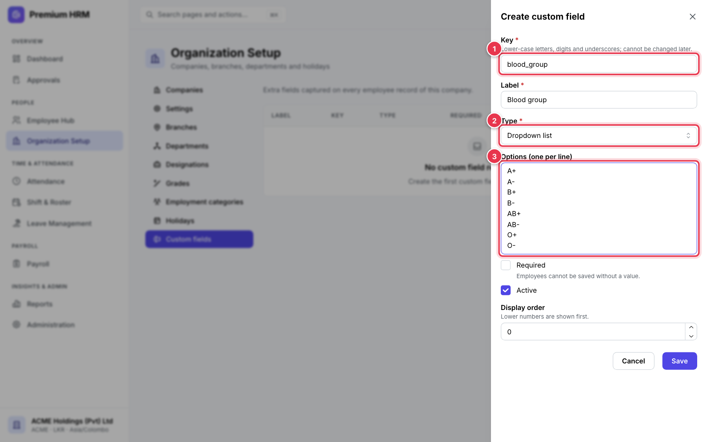

The field appears in an *Additional information* section on every employee form. Untick **Active** to hide a
field from forms later; values already entered are kept.

---

## 6. Shifts and overtime policies

Shifts tell the system when people are expected to work, so it can work out lateness, early departure,
short hours and overtime. Open **Shift & Roster**. This chapter covers the **Shifts** and **OT policies**
tabs. Rosters and rotations are covered in [10. Rosters and schedules](#10-rosters-and-schedules).

### 6.1 Overtime policies

Create the overtime policy first, because shifts refer to it.

1. Open **Shift & Roster → OT policies** and click **Create OT policy**.
2. Fill in the rules:

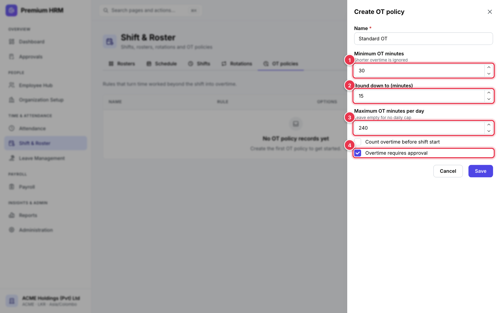

| # | Field | Meaning |
|---|---|---|
| 1 | **Minimum OT minutes** | Overtime shorter than this is ignored (default 30). |
| 2 | **Round down to (minutes)** | Overtime is rounded down to this unit (default 15). 52 minutes with a 15-minute unit counts as 45. |
| 3 | **Maximum OT minutes per day** | A daily cap. Leave it empty for no cap. |
| 4 | **Overtime requires approval** | When ticked, overtime is paid only after a manager approves it on the *Exceptions* tab ([9.6](#96-approve-overtime)). |

**Count overtime before shift start** decides whether arriving early counts as overtime (off by default).

> [!NOTE]
> Overtime **rates** (×1.5, ×2 …) are not set here. They are part of the payroll components
> *OT workday*, *OT weekly-off* and *OT holiday* ([13.1](#131-payroll-components)).

### 6.2 Create a shift

1. Open **Shift & Roster → Shifts** and click **Create shift**.
2. Fill in the form (it is long — scroll down for the second half):

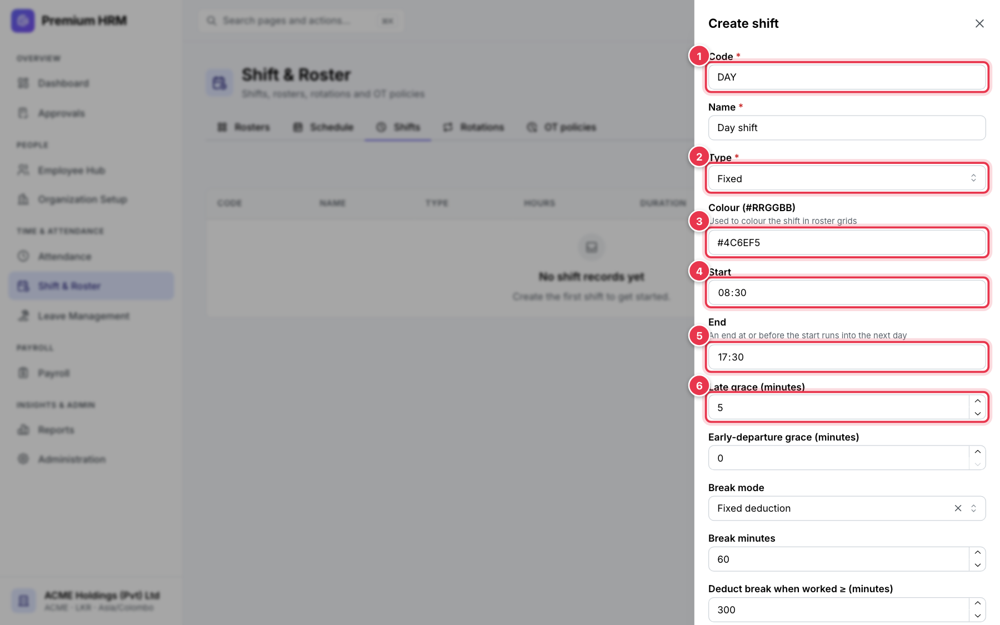

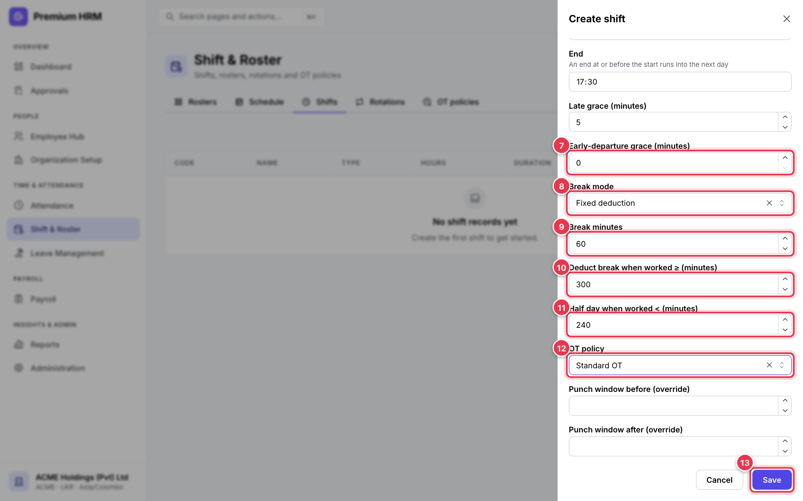

| # | Field | Meaning |
|---|---|---|
| 1 | **Code** | For example `DAY`, with the **Name** *Day shift* below it. The code is what you see in roster grids. |
| 2 | **Type** | *Fixed* (same hours every day), *Flexible* (any start between an earliest and latest time, with a required number of hours), *Night* (crosses midnight), *Split* (two sessions in one day) or *Custom*. |
| 3 | **Colour** | Colour used in roster grids, e.g. `#4C6EF5`. |
| 4–5 | **Start**, **End** | Shift times (24-hour). If the end is at or before the start, the shift ends the next day — allowed only for *Night* (which must cross midnight) and *Custom* shifts. |
| 6 | **Late grace (minutes)** | Arrivals within this many minutes after the start are not counted as late. |
| 7 | **Early-departure grace** | The same, for leaving early. |
| 8 | **Break mode** | *Fixed deduction* deducts the break minutes automatically; *Punched breaks* uses the gaps between punches instead. |
| 9–10 | **Break minutes**, **Deduct break when worked ≥** | For example deduct 60 minutes, but only when the employee worked at least 300 minutes. |
| 11 | **Half day when worked <** | A day with fewer worked minutes than this is a half day. |
| 12 | **OT policy** | The overtime rules for this shift. Without one, the policy of the employee's default shift is used; if neither has one, no overtime is earned. |
| 13 | **Save** | Saves the shift. |

The **Punch window** fields at the bottom override the company's punch window for this shift only.

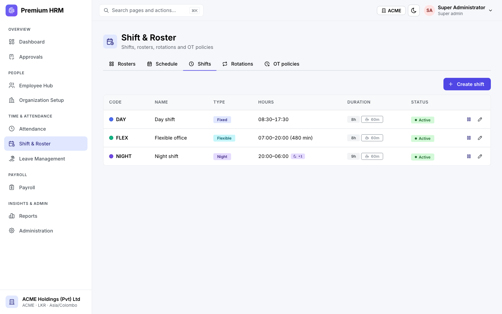

Night shifts are marked **+1** because they end the next day. All punches of a night shift are counted on the
day the shift *starts*. Shifts cannot be deleted. Use the pause icon to **deactivate**
them instead, and they disappear from the pick-lists.

**Flexible shifts** have no fixed start: instead of *Start* and *End* you enter the **Earliest start**, the
**Latest end** and the **Required minutes** per day. Flexible shifts have no late or early-departure
minutes. Only short hours and overtime are counted, both measured against the required minutes.

---

## 7. Employees

**Employee Hub** is the master list of everyone in the company. Each employee has a profile, an employment
history, documents and (for payroll users) a salary structure.

### 7.1 Find an employee

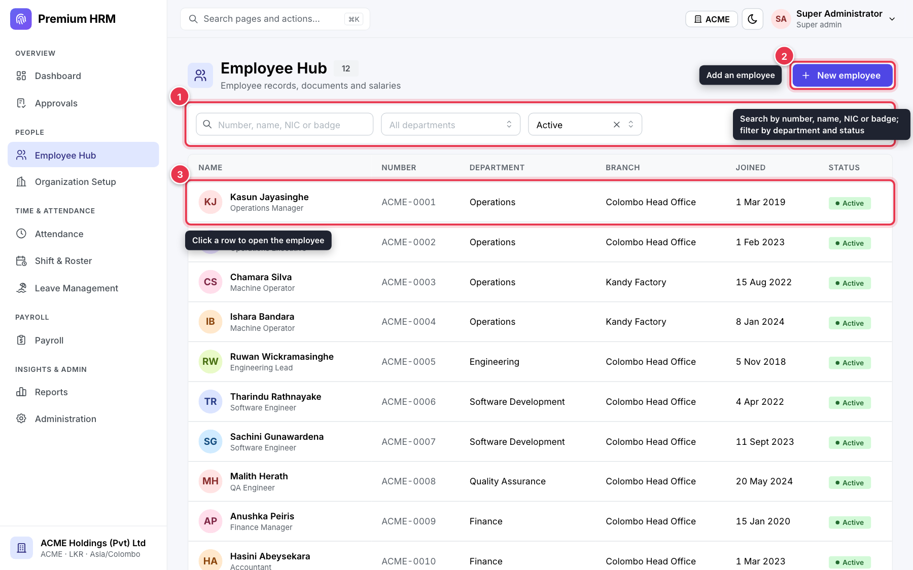

1. **Search and filters** (1) — type part of a number, name, NIC or badge ID. Narrow the list by department
   and status. The list shows **Active** employees by default; clear the status filter to see everyone.
   Once you change a filter, **Clear filters** appears and returns to the default view (active employees, no
   search or department).
2. **New employee** (2) adds a person ([7.2](#72-add-an-employee)).
3. Click any row (3) to open the employee's record.

The count next to the title is the number of matching employees. Long lists are split into pages of 25.

> [!TIP]
> From anywhere in the system, press **Ctrl/⌘ + K** and type part of a name to jump straight to an employee.

### 7.2 Add an employee

Click **New employee**. The form has four sections. Fields with a red asterisk are required.

**Personal**

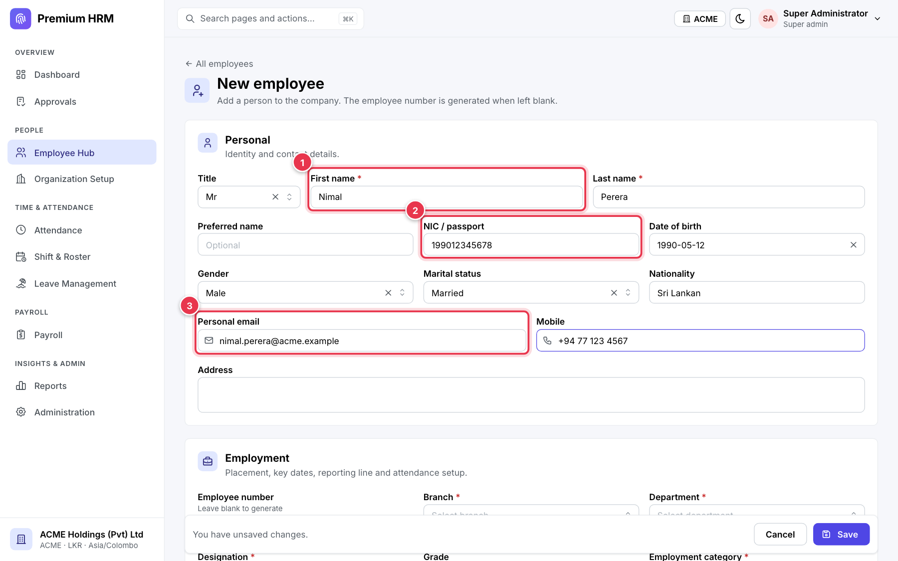

| # | Field | Notes |
|---|---|---|
| 1 | **First name**, **Last name** (required) | Title and preferred name are optional. |
| 2 | **NIC / passport** | Must be unique within the company. |
| 3 | **Personal email**, **Mobile** | The email is used for payslip emails. |

Date of birth, gender, marital status, nationality and address are optional.

**Employment**

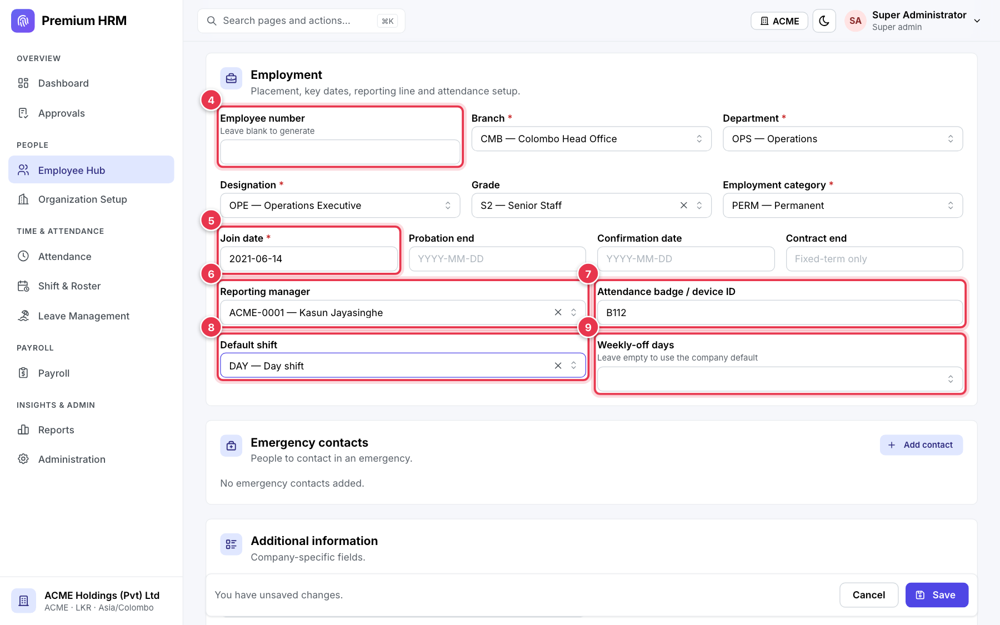

| # | Field | Notes |
|---|---|---|
| 4 | **Employee number** | Leave it blank and the system generates the next number using the company format. Only users with `EMPLOYEE:CONFIGURE` can type their own. |
| — | **Branch, Department, Designation, Employment category** (required), **Grade** | The placement. These must exist first ([5](#5-organization-setup)). |
| 5 | **Join date** (required) | Also used for leave pro-rating and payroll proration. Probation end, confirmation date and contract end are optional. |
| 6 | **Reporting manager** | The person who approves this employee's leave (with the default workflow). |
| 7 | **Attendance badge / device ID** | The ID the fingerprint or card device sends. Punches are matched to the employee by this ID or by employee number. |
| 8 | **Default shift** | Used on days when no roster or rotation applies. |
| 9 | **Weekly-off days** | Leave empty to use the company default. |

**Emergency contacts and additional information**

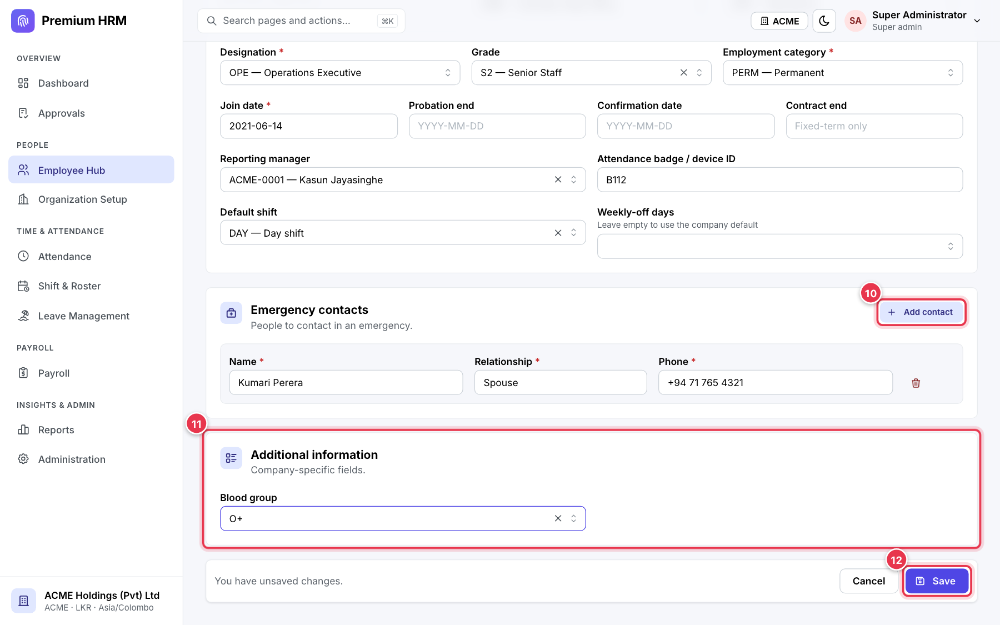

- Click **Add contact** (10) for each emergency contact (name, relationship and phone are required). Use the
  bin icon to remove one.
- **Additional information** (11) contains your company's custom fields ([5.7](#57-custom-employee-fields)).
- Click **Save** (12). The bar at the bottom always tells you whether you have unsaved changes.

The new record opens, showing the generated number (1):

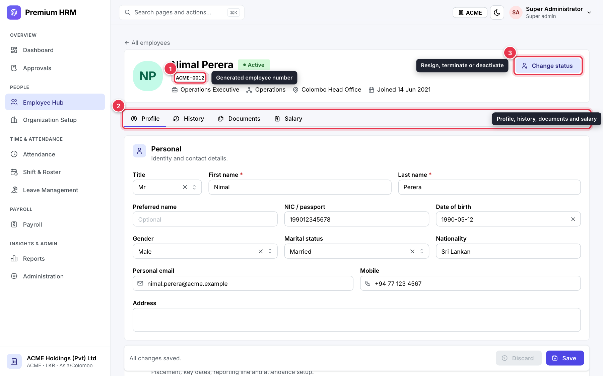

The header shows the status, number, designation, department, branch and join date. The tabs (2) are
**Profile** (the form you just filled in), **History**, **Documents** and — for payroll users — **Salary**.

### 7.3 Edit an employee, transfers and promotions

Open the employee, change the fields on the **Profile** tab and click **Save**. At the bottom, the **Change details** section lets you
enter the **Change effective date** (default today) and a **Reason for change**, for example *Annual
promotion 2025*. Changes to the branch, department, designation, grade, employment category, reporting
manager or status are recorded in the employment history:

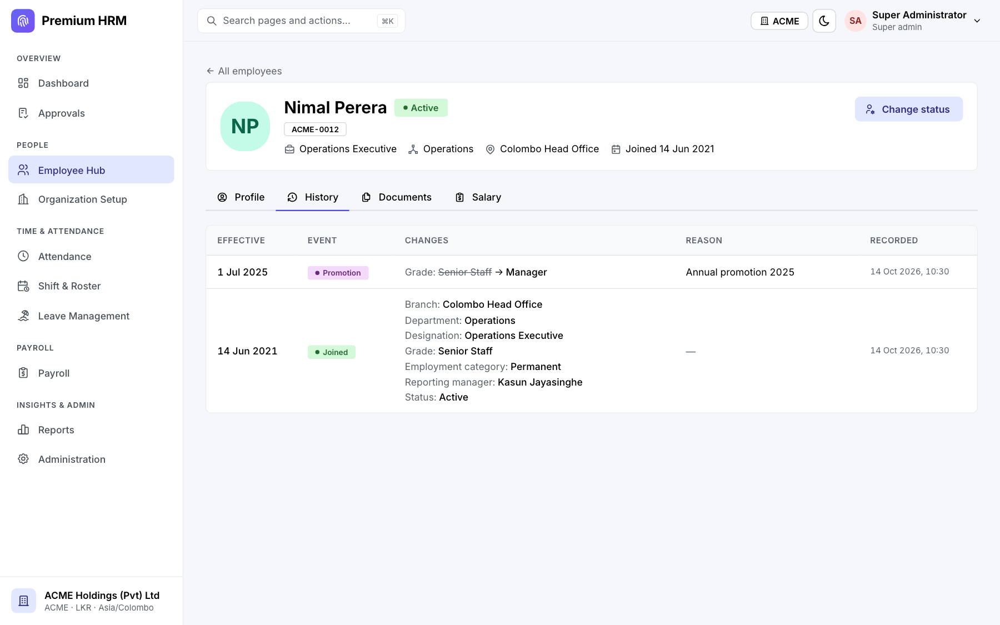

> [!NOTE]
> If someone else saved the same employee while you were editing, you are asked to reload instead of
> overwriting their changes.

### 7.4 Change status: resignation, termination, deactivation

Employees are never deleted, so their history, attendance and payslips are kept. To end employment (needs
`EMPLOYEE:EDIT`):

1. Open the employee and click **Change status** (3 in the profile screenshot).
2. Choose **Resigned**, **Terminated**, **Inactive** or (to reverse) **Active**. Each option explains what it
   means.
3. For *Resigned* or *Terminated*, enter the **Exit date** (the last day of employment). Enter a **Reason** —
   it is required for every status except *Active*.
4. Click **Save**.

After the exit date the employee is excluded from attendance, leave and payroll. Their last salary is
prorated to the exit date in the final payroll, using the salary structure in effect on that date.

### 7.5 Documents

Store contracts, IDs and certificates with the employee record.

*Required permission:* `EMPLOYEE:EDIT` to upload, `EMPLOYEE:DELETE` to delete.

1. Open the employee → **Documents**.
2. Choose the **Type** (1) (NIC, Birth Certificate, Contract, Certificate, Other), enter a **Title** (2), an
   optional **Expiry** date (3) and choose the **File** (4) — PDF, JPG, PNG or DOCX up to 10 MB.
3. Click **Upload** (5).

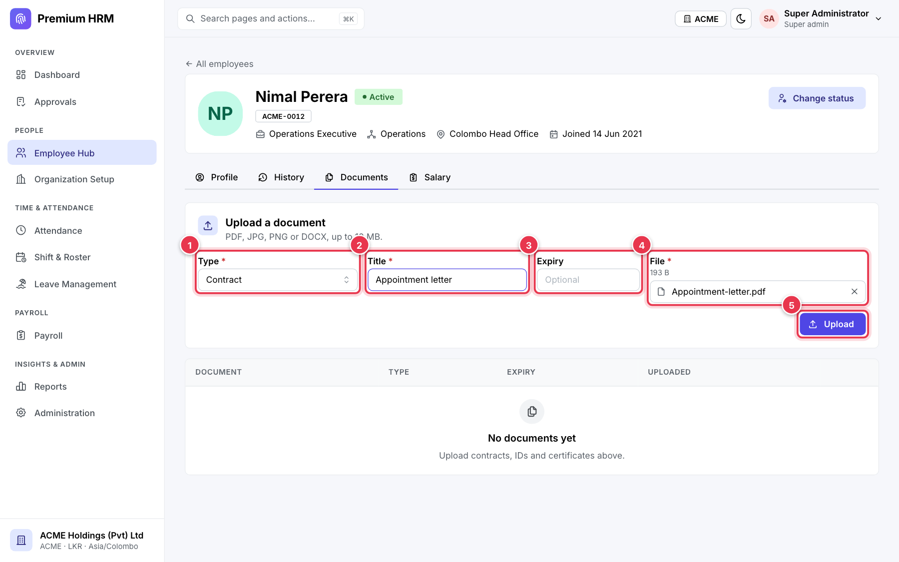

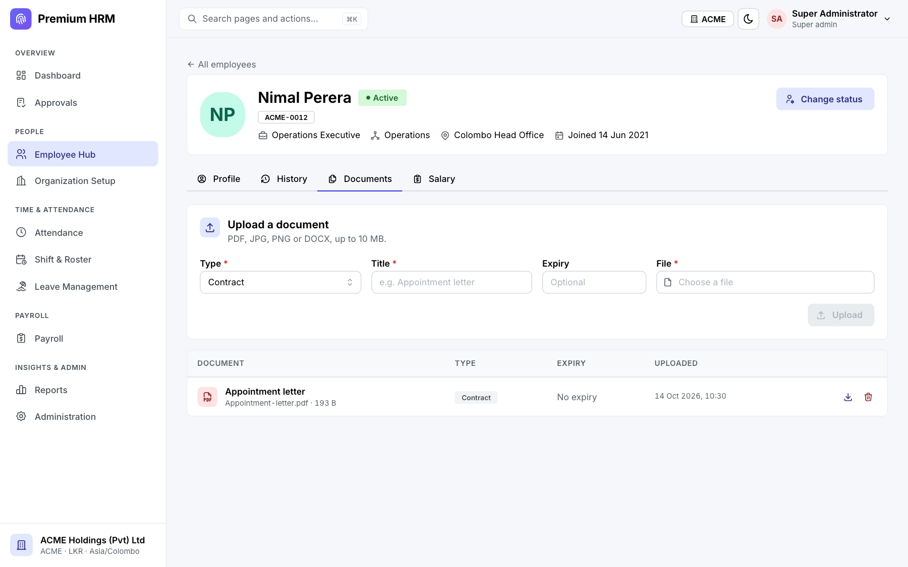

Documents that expire within 30 days are flagged **Expires in … d**, and expired ones **Expired**. Use the
download icon to open a document. Employees can download their own documents from My Portal.

### 7.6 Salary structure

*Required permission:* `PAYROLL:VIEW` to see the **Salary** tab, `PAYROLL:EDIT` to change it. Salary is
never shown on the profile itself.

1. Open the employee → **Salary** → **New structure**.
2. Enter the **Effective from** date (1) — the first day the new pay applies — and the monthly **Basic
   salary** (2).
3. To add allowances or fixed deductions, click **Add component** (5), choose the **Component** (3) and enter
   the **Amount** (4). For percentage or overtime components you can override the rate or multiplier for this
   employee, and for automatic components you can tick **Exclude**.
4. Click **Save**.

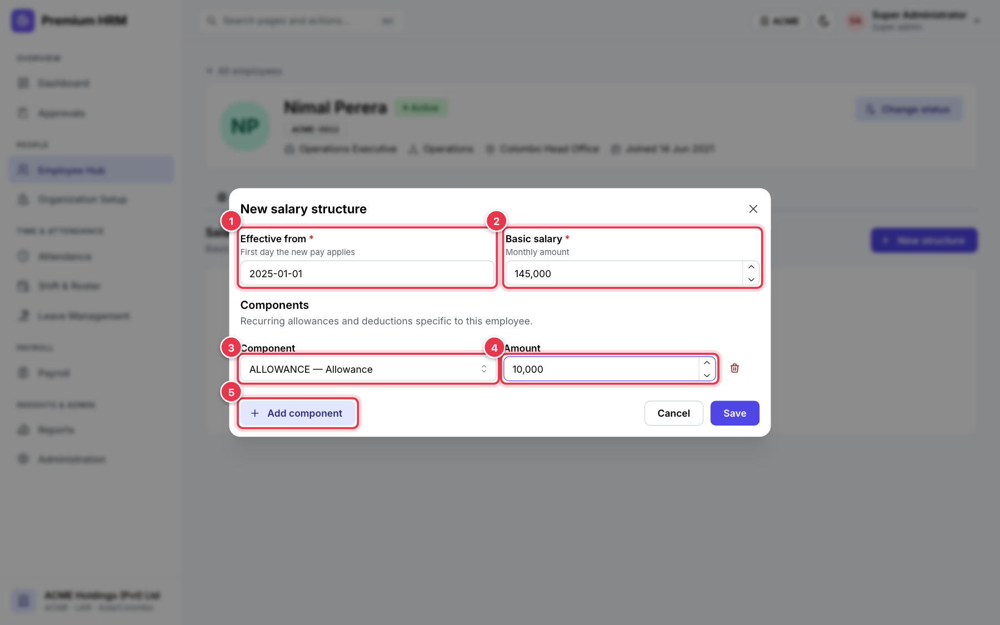

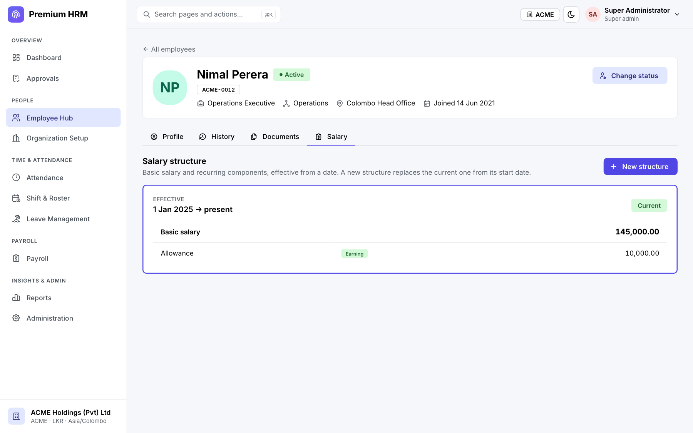

A new structure replaces the previous one from its effective date. The old one is kept as history and
labelled **Past**. Payroll uses the structure that is in effect on the last day of the pay period (for a leaver, on the exit date).

> [!IMPORTANT]
> Employees without a salary structure are **skipped** by payroll and listed as an exception. Enter
> salary structures before your first payroll run.

---

## 8. Users, roles and permissions

Employees and users are different things. An **employee** is a person on the payroll. A **user** is a login.
A user can be linked to one employee, which gives them **My Portal**. Administrators, HR staff and managers
are users. Most of them are also linked to their own employee record.

*Required permission:* `ADMIN:VIEW` to open **Administration**, `ADMIN:ADD/EDIT` to manage users,
`ADMIN:CONFIGURE` and the *All data* scope to manage roles.

### 8.1 Create a user

1. Open **Administration → Users** and click **Create user**.
2. Fill in the form:

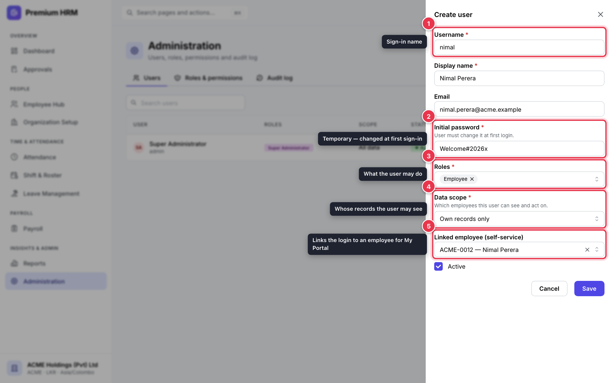

| # | Field | Notes |
|---|---|---|
| 1 | **Username** | The sign-in name, unique and not case-sensitive. **Display name** (required) is shown in the app; email is optional. |
| 2 | **Initial password** | A temporary password that follows the password rules. Give it to the user securely. They must change it at first sign-in. |
| 3 | **Roles** | One or more roles. They decide what the user can *do* (see the table below). |
| 4 | **Data scope** | Whose records the user can *see*: **All data**, **Selected companies**, **Selected branches**, **Selected departments** (including sub-departments) or **Own records only**. |
| 5 | **Linked employee** | Links the login to an employee record. This gives the user My Portal and lets them approve as that employee's manager. |

3. Click **Save**.

**Typical set-ups**

| Person | Roles | Data scope | Linked employee |
|---|---|---|---|
| HR manager | HR Manager | All data | Their own record |
| Payroll officer | Payroll Officer | Selected companies | Their own record |
| Department head | Department Manager | Selected departments → their department | Their own record |
| Branch manager | Branch Manager | Selected branches → their branch | Their own record |
| Employee | Employee | Own records only | Their own record |
| External auditor | Auditor | All data | — |

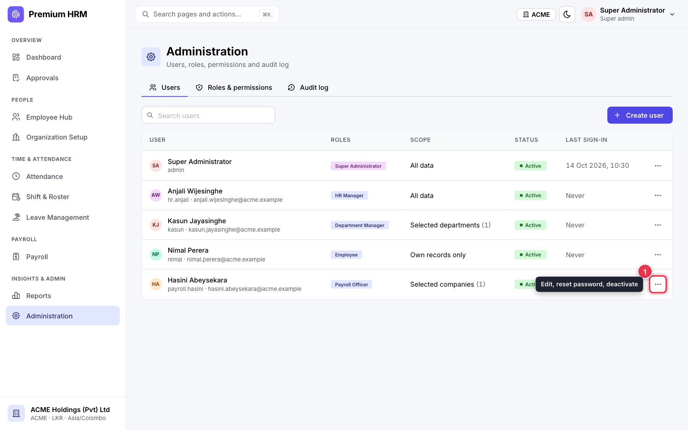

The **…** menu on each row (1) lets you **Edit**, **Reset password** or **Deactivate** a user. For a reset you
enter a new temporary password (it must follow the password rules). The user is signed out everywhere and
must change it at the next sign-in. A deactivated user cannot sign in, and the
last active Super Administrator cannot be deactivated. A **Locked** badge means the account is temporarily
locked after failed sign-ins. It unlocks by itself after 15 minutes.

### 8.2 Roles and the permission matrix

**Administration → Roles & permissions** lists the nine built-in roles with their number of permissions:

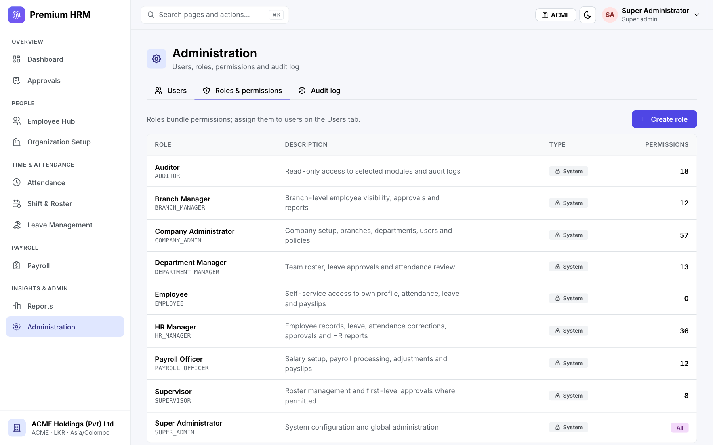

Click a role to see or change its permissions. Permissions are arranged as a matrix: one row per module and
one column per action (**View, Add, Edit, Delete, Approve, Export, Configure**). Tick the module checkbox (1)
to grant every action of a module, or tick single actions (2).

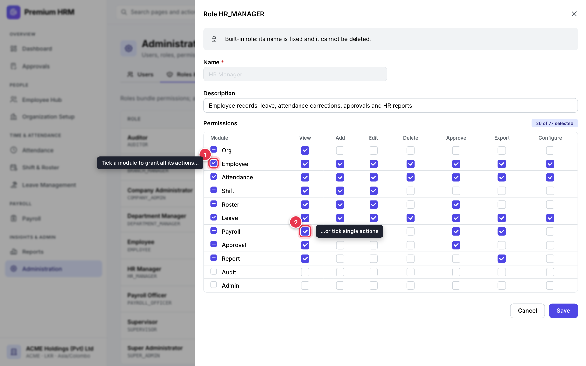

- **Built-in roles** cannot be renamed or deleted, but you can change their permissions (except Super
  Administrator, which always has everything).
- **Custom roles:** click **Create role**, enter an upper-case **Code** (e.g. `PAYROLL_CLERK`), a name and a
  description, tick the permissions and click **Save**.

The default permissions of each built-in role are listed in [Appendix B](#appendix-b--default-roles).

> [!WARNING]
> Changes to a role apply immediately to every user who has it. Review the users of a role before you remove
> permissions.

---

## 9. Attendance

Premium HRM turns raw clock-in/clock-out **punches** into one **daily attendance record** per employee per
day. Each record has a status, worked hours, late and early minutes, short hours and overtime. The record
is calculated from:

- the punches (from devices, the integration API or a CSV file),
- the employee's schedule for the day (roster → rotation → default shift; see
  [10.6](#106-how-the-days-schedule-is-decided)),
- holidays, approved leave and manual corrections.

Records are recalculated automatically every night for the previous day, as soon as new punches arrive, and
whenever leave, rosters or corrections change. You can also recalculate on demand.

Open **Attendance**. It has three tabs: **Daily attendance**, **Exceptions** and **Import & devices**.

### 9.1 Connect attendance devices

Each fingerprint/card terminal, or the middleware that collects their data, is registered as an
**attendance source** with its own API key.

*Required permission:* `ATTENDANCE:CONFIGURE`.

1. Open **Attendance → Import & devices**.
2. Under *Attendance sources*, enter a **Source name** (1), for example *Main gate terminal*, keep the format
   **Generic JSON** and click **Add source** (2).

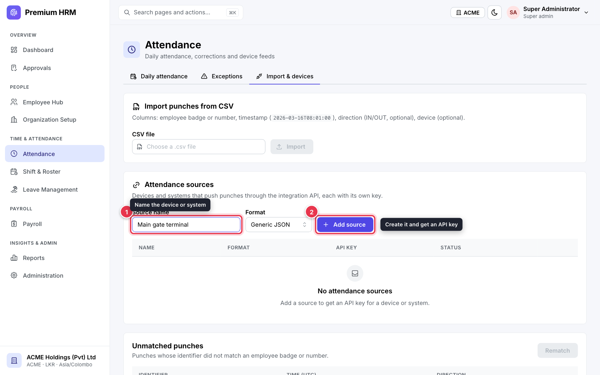

3. The new **API key** is shown. **Copy it now** (2) — it is shown only once (1). Give the key and the
   address shown under *How to use it* (3) to your device vendor or integrator, then click **I have saved
   the key**.

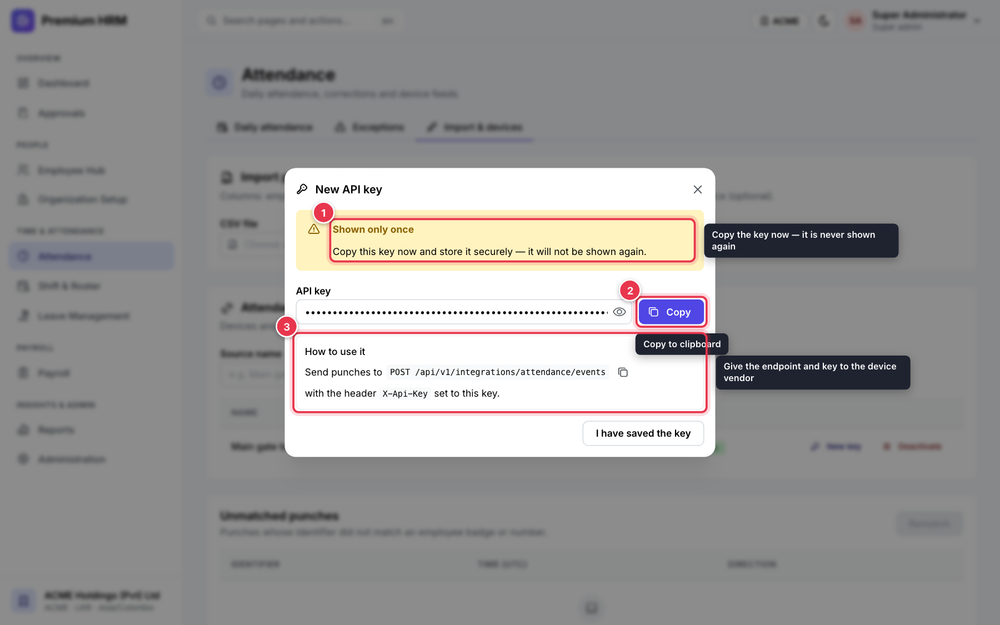

Devices send punches to `https://<your-server>/api/v1/integrations/attendance/events` with the header
`X-Api-Key: <key>`. The request format is in [Appendix D](#appendix-d--attendance-integration-reference).
Sending the same punch twice is harmless, because duplicates are recognised and skipped.

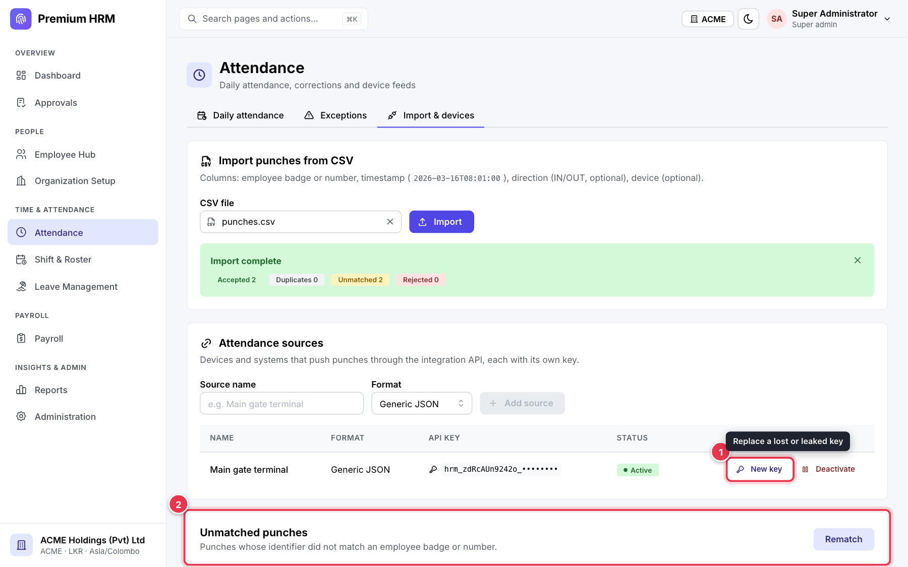

- **New key** (1) replaces a lost or leaked key. The old key stops working immediately.
- **Deactivate** stops a source from sending punches, and **Activate** allows it again.
- **Unmatched punches** (2) lists punches whose badge ID matched no employee — typically a new employee whose
  badge ID was not entered yet. Enter the badge ID on the employee's profile, then click **Rematch** (needs
  `ATTENDANCE:EDIT`) to attach the stored punches to them.

### 9.2 Import punches from a CSV file

If a device cannot connect directly, export its punches to a CSV file and import them.

*Required permission:* `ATTENDANCE:ADD`.

1. Prepare a CSV with the columns *employee badge or number*, *timestamp* (for example
   `2026-10-13T08:12:00`), *direction* (`IN` / `OUT`, optional) and *device* (optional). A header row is
   allowed.
2. Open **Attendance → Import & devices**, choose the file under **Import punches from CSV** and click
   **Import**.
3. The result (1) shows how many rows were **accepted** (stored, including any unmatched ones), **duplicates** (already imported), **unmatched** (no
   employee with that badge) and **rejected** (invalid rows; the first ten are listed with the row number and reason).

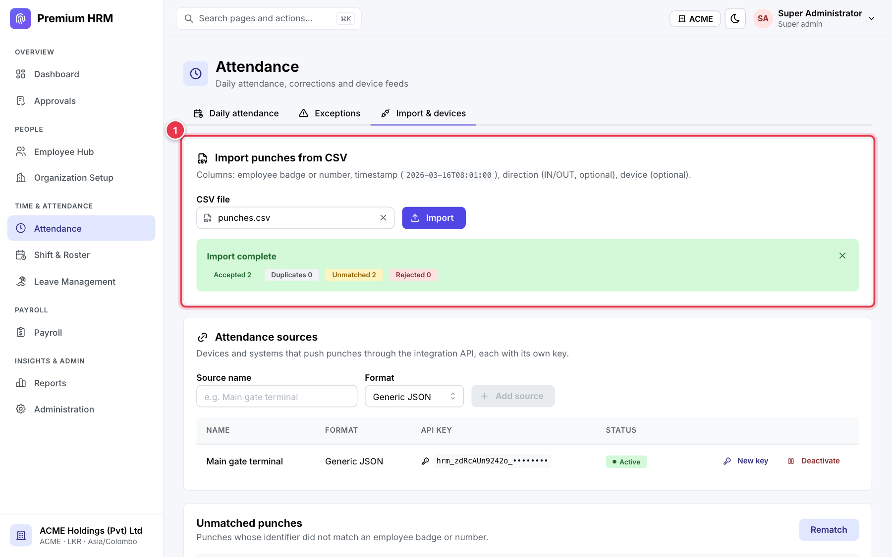

Timestamps without a time-zone offset are read in the company's time zone. Importing the same file again
does not create duplicates.

### 9.3 Daily attendance

**Attendance → Daily attendance** shows one row per employee per day.

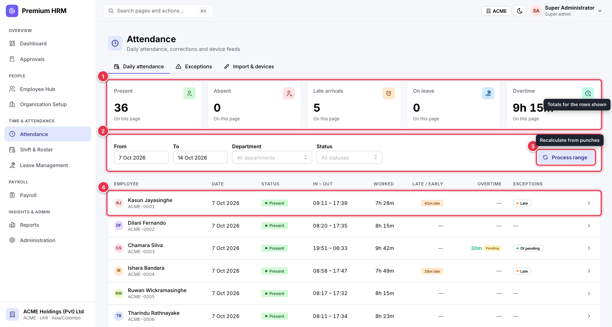

| # | Area | What it shows |
|---|---|---|
| 1 | **Summary cards** | Present, absent, late arrivals, on leave and total overtime for the rows shown |
| 2 | **Filters** | Date range (**From**, **To**; the past week up to today by default), **Department** and **Status** |
| 3 | **Process range** | Recalculates the selected dates from the punches (needs `ATTENDANCE:EDIT`) |
| 4 | **Rows** | Status, first IN – last OUT, worked time, late/early minutes, overtime (with its approval state) and exceptions. Click a row to open the day. |

**Attendance statuses**

| Status | Meaning |
|---|---|
| **Present** | Worked the day |
| **Half day** | Worked less than the shift's half-day threshold |
| **Absent** | Scheduled to work, no punches, no leave |
| **On leave** / **Half day leave** | Approved leave covers the day (or half of it) |
| **Weekly off** | A scheduled day off |
| **Holiday** | A holiday that applies to the employee's branch |
| **Incomplete** | A punch is missing (for example IN without OUT) |
| **Unscheduled** | A working day but no shift could be determined |

Calculation rules in brief:

- **Late** = first IN after shift start + late grace (counted from the shift start). **Early** works the same
  way at the end of the shift.
- **Worked** = time between punches, minus the break (fixed deduction) when the threshold is reached.
- **Short** = scheduled hours minus worked hours.
- **Overtime** = time after the shift end (and before the start, if the OT policy allows), after applying the
  policy's minimum, rounding and daily cap. On a weekly-off day or a holiday, all time worked counts as
  off-day or holiday overtime (subject to the same policy rules). Employees in a category that is not overtime-eligible get *extra hours*
  instead.
- Several IN/OUT pairs in a day are supported. Night-shift punches count on the day the shift started.

### 9.4 Look at a day and correct missing punches

Use the **Status** filter to find problem days, for example **Incomplete**:

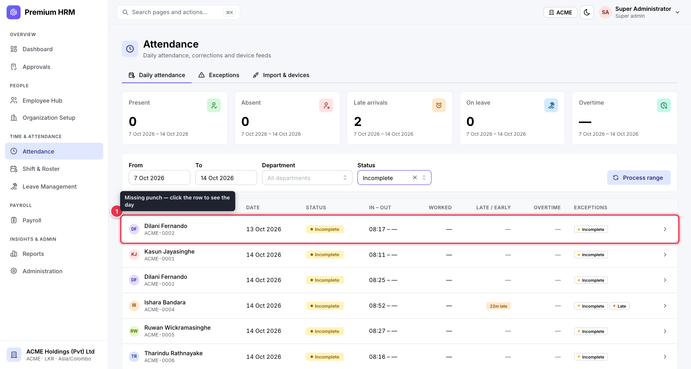

Click the row (1) to open the day. The panel shows the calculated figures, the **raw punches** exactly as the
device sent them (1) — punches just before or after the day are listed too, with their date — any earlier corrections and a correction form.

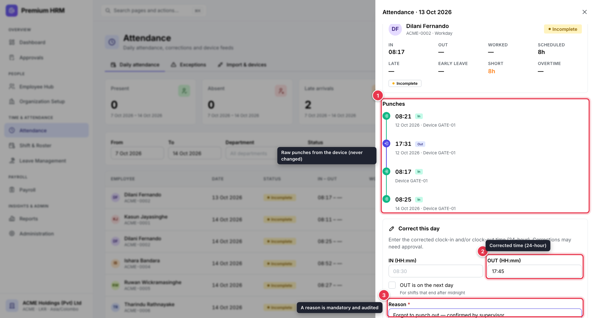

To correct the day:

1. Enter the corrected **IN** and/or **OUT** time in 24-hour format (2). If the shift ends after midnight,
   tick **OUT is on the next day**.
2. Enter the **Reason** (3). It is mandatory and is kept in the audit log.
3. Click **Submit correction**.

The day is recalculated immediately and the correction is listed under **Corrections**, with the before and
after times, the reason and the time it was made (1). The original punches are never changed.

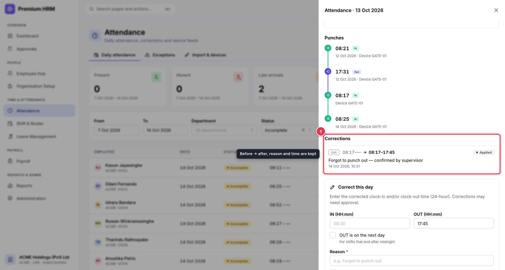

> [!NOTE]
> If your company has enabled the **Attendance correction** approval workflow
> ([12.5](#125-approval-workflows)), the correction is created as *Pending* and the day changes only after
> it is approved. By default this workflow is disabled and corrections apply immediately.

The same form creates a **manual attendance record** for a day without any punches (for example an employee
who worked at a client site); enter both IN and OUT. Creating a record needs `ATTENDANCE:ADD`, correcting an
existing day `ATTENDANCE:EDIT`.

### 9.5 Exceptions

**Attendance → Exceptions** lists only the days that need attention: **Incomplete**, **Absent**, **Late**,
**Early** (departure), **Unscheduled** and **Ot pending** (overtime waiting for approval). Filter by date,
department and exception type.

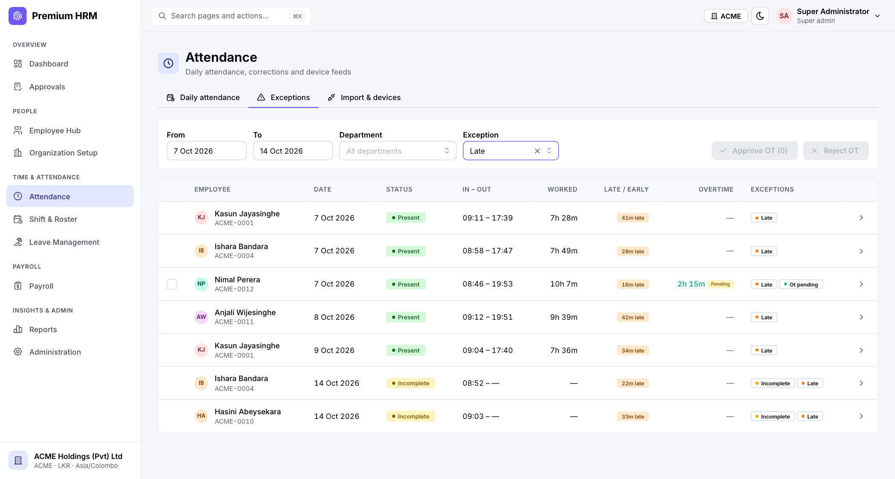

Work through this list before each payroll run. The payroll period also shows how many attendance
exceptions are still open.

### 9.6 Approve overtime

When a shift's OT policy requires approval, overtime counts for pay only after it is approved.

*Required permission:* `ATTENDANCE:APPROVE` (for example department and branch managers).

1. Open **Attendance → Exceptions** and set the **Exception** filter to **Ot pending** (1).
2. Tick the days you want to decide (2).
3. Click **Approve OT** or **Reject OT** (3). **Approve OT** shows how many days are selected.

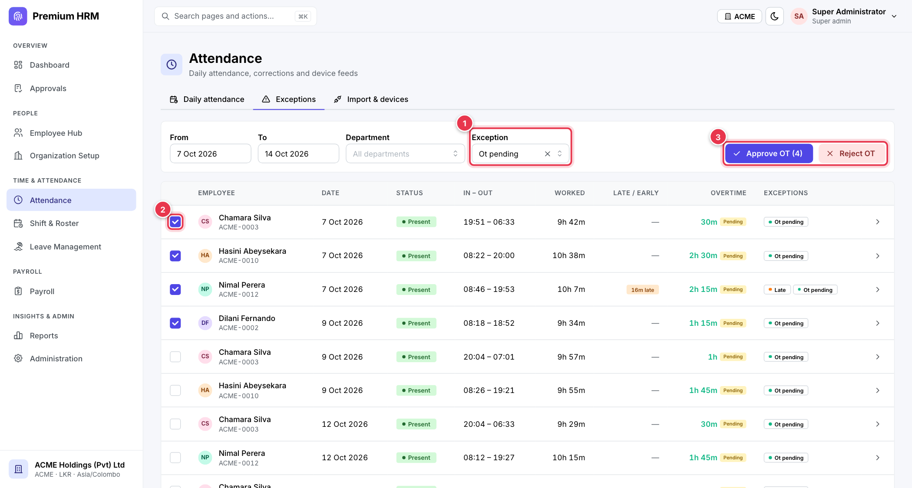

Rejected overtime is not paid. Both decisions are audited, and they are kept when attendance is recalculated
later.

### 9.7 Payroll lock

When a payroll period is submitted for review, approved or finalized, the attendance of its dates is
**locked**. Corrections, overtime decisions and leave changes for those dates are refused with the message
*"Attendance on … is locked by payroll"*, and **Process range** skips those dates (it reports how many were
locked), so the figures cannot change under the payroll. A user with
`ATTENDANCE:CONFIGURE` can tick **Override payroll lock (audited)** for a single correction. The override is
recorded, and finalized payslips are never changed.

---

## 10. Rosters and schedules

A **roster** assigns a shift (or a day off) to each employee for each day of a week or a month. Use rosters
when working hours change from week to week. If an employee always works the same shift, their **default
shift** is enough. If they follow a regular repeating cycle, use a **rotation**.

Open **Shift & Roster**. The tabs are **Rosters**, **Schedule**, **Shifts**, **Rotations** and
**OT policies**.

### 10.1 Rotation patterns

A rotation is a repeating cycle such as *two days, two nights, two days off*.

1. Open **Shift & Roster → Rotations** and click **Create pattern**.
2. Enter a **Name**. Under **Cycle days** (1) choose the shift — or **OFF** — for *Day 1*. Click **Add day**
   (2) for each further day of the cycle (up to 62 days).
3. Click **Save**.


To use the pattern, click **Assign employees** (1) on its row. Choose the employees, the **Start date (cycle day 1)**
and, optionally, the **End date (optional)**, then click **Assign**.


### 10.2 Create a roster

*Required permission:* `ROSTER:ADD`.

1. Open **Shift & Roster → Rosters**. Use the **Month** box to see rosters of another month.
2. Click **Create roster** and fill in:


| # | Field | Notes |
|---|---|---|
| 1 | **Name** | For example *Operations — week of 19 Oct*. |
| 2 | **Period** | **Weekly** (7 days) or **Monthly** (a calendar month). |
| 3 | **Start date** | For weekly rosters, the company's week-start day (Monday by default). For monthly rosters, the 1st. |
| 4 | **Department (optional)** | Limit the roster to one department and its sub-departments. Leave empty for the whole company. |

3. Click **Create**. The roster opens as a **Draft** grid of employees × days.

### 10.3 Fill the roster

*Required permission:* `ROSTER:EDIT`.

**Bulk assign** is the fastest way to fill a roster:

1. Click **Bulk assign**.
2. Choose the **Employees** (1) — or click **Select all** — and the **From** / **To** dates (2).
3. Optionally limit it to certain weekdays (3). For example, choose Monday to Friday and leave the weekend
   for a second bulk assignment of **OFF**.
4. Choose the **Shift** (4) — or **OFF (day off)** — and click **Assign** (5).


Then fine-tune individual days directly in the grid:


| # | Control | Use |
|---|---|---|
| 1 | **Bulk assign** | Assign a shift to many employees and days at once. |
| 2 | **Any cell** | Pick a shift code, **OFF**, or blank. Changed cells are outlined in yellow until saved. Weekends are shaded and holidays highlighted; hover over a holiday's column heading to see its name. |
| 3 | **Save (n)** | Saves all pending changes in one go. **Discard** throws them away. |
| 4 | **Validate** | Checks for clashes without saving, for example the same employee in two published rosters, overlapping consecutive shifts (a night shift followed by an early morning shift) or an inactive shift. |
| 5 | **Publish** | Makes the roster official. It is available once all changes are saved. |

For a new roster, you can also start from a copy: choose **Copy from another roster…** and click **Copy**.
Day 1 of the source is copied to day 1 of the new roster, and so on.

### 10.4 Publish, change and lock

*Required permission:* `ROSTER:APPROVE` to publish and lock, `ROSTER:CONFIGURE` to unlock.

After you click **Publish**, the roster is **Published** (1). Employees see it in My Portal, and it drives
their attendance from now on.


- **Changing a published roster** is still possible. When you save, you are asked for a **reason**. Each
  saved change increases the **revision** number, and **Revisions** shows what changed, when and why (each
  save is also recorded, with the user, in the audit log).
  Attendance of the affected days is recalculated.
- **Lock** (2) freezes the roster completely, for example after the period is paid. **Unlock** needs a reason
  and is recorded in the audit log.

### 10.5 Schedule view

**Shift & Roster → Schedule** shows what everyone actually works in a week, whichever way it was planned.
Use **Previous week**, **This week** and **Next week**, or pick the **Week starting** date and a department.
Hover over a cell to see where the shift came from (*Roster*, *Rotation* or *Default*).


### 10.6 How the day's schedule is decided

For each employee and day, the system uses the first of these that applies:

1. an entry in a **published or locked roster**;
2. an active **rotation** assignment;
3. the employee's **default shift** and weekly-off days (or the company's weekly-off days).

Then, if a holiday applies to the employee's branch, the day becomes a **holiday**. If the result is a working
day without any shift, the day is **unscheduled** and appears in the exceptions.

---

## 11. Leave management

Open **Leave Management**. The tabs are **Requests**, **Calendar**, **Balances**, **Leave types** and (for
administrators) **Jobs**.

### 11.1 Leave types and policies

Each company starts with four leave types, which you can edit:


| Leave type | Days / year | Paid | Accrual |
|---|---|---|---|
| Annual leave | 14 | Yes | Annual (upfront), pro-rated for joiners |
| Casual leave | 7 | Yes | Annual (upfront), pro-rated for joiners |
| Medical leave | 7 | Yes | Annual (upfront) |
| No pay leave | Unlimited | No | — (no balance) |

Click a leave type to change its policy, or **Create leave type** to add one (for example *Maternity* or
*Lieu leave*).


| # | Setting | Meaning |
|---|---|---|
| 1 | **Days per year** | The yearly entitlement (in steps of 0.5). |
| 2 | **Accrual** | **Annual (upfront)** credits the full entitlement on 1 January. **Monthly** credits 1/12 at the start of each month. |
| 3 | **Pro-rate for joiners** | Someone joining during the year gets only the remaining months' share (rounded down to half days). |
| 4 | **Max carry-forward days** | How many unused days move into the next year (0 = none). |
| 5 | **Carry-forward expires after month** | Carried days not used by the end of this month of the new year lapse (0 = never). |

Further options:

- **Paid leave** — unpaid leave days are deducted as no-pay in payroll.
- **Unlimited (no balance)** — no balance is tracked (e.g. *No pay leave*).
- **Allow half days** — the employee can apply for a morning or an afternoon.
- **Allow negative balance** — lets employees go below zero.
- **Count weekly-off days**, **Count holidays** — when unticked (the normal case), weekends and holidays inside
  a leave period are not deducted.
- **Require attachment above (days)** — for example, a medical certificate for more than 2 days.
- **Eligible categories** — limit the type to certain employment categories (empty = everyone).
- **Colour (#RRGGBB)** — used on the leave calendar.

### 11.2 Apply for leave (employee)

Employees apply in **My Portal → Leave → Apply for leave**:


1. Choose the **Leave type** (1). The available balance for the year is shown immediately (2).
2. Pick the **Dates** (3): click the first and the last day in the calendar. For a single day, click the same
   day twice. If you pick a single day and the type allows half days, a **Duration** choice (*Full day*,
   *Morning*, *Afternoon*) appears.
3. Check the number of days (4). Weekly-off days and holidays are excluded according to the policy. A warning
   appears if the request exceeds the balance.
4. Add a **Reason** for your approver and, if needed, **Supporting documents** (PDF, image or DOCX).
5. Click **Apply** (5).


Your balances for the year are shown at the top (1). The request appears under *My requests* as **Pending**
(2), and the days are reserved in the balance as *pending* until a decision is made. The employee can
**Cancel** a pending request.

The system refuses a request that overlaps another pending or approved leave, crosses into the next year,
exceeds the balance (unless negative balances are allowed), falls in a locked payroll period or is for a type
the employee is not eligible for. The reason is shown on screen.

### 11.3 Apply on behalf of an employee (HR)

*Required permission:* `LEAVE:ADD`.

On **Leave Management → Requests**, click **Apply on behalf**, choose the **Employee**, and fill in the same
form. The request goes through the same approval workflow.

### 11.4 Approve leave (manager)

With the default workflow, a leave request goes to the employee's **reporting manager**. The manager sees a
counter on **Approvals** in the menu and the request in their **Inbox** (see [12.1](#121-your-inbox)). Approving is covered in
[12.2](#122-review-and-decide).

When the leave is approved, the days move from *pending* to *taken*, and attendance for those days becomes
**On leave**. When it is rejected, the days are released.

### 11.5 Track requests

**Leave Management → Requests** lists all requests you are allowed to see.


| # | Control | Use |
|---|---|---|
| 1 | **Search employee** | Find an employee's requests by name or number. |
| 2 | **Status** | **Pending** by default. Switch to *Approved*, *Rejected*, *Cancelled* or clear it for all. |
| 3 | **Leave type** | Show one type only. |
| 4 | **Apply on behalf** | Apply for an employee ([11.3](#113-apply-on-behalf-of-an-employee-hr)). |

Click a request to see its details and attachments. Users with `LEAVE:EDIT` can **cancel** a pending or
approved request there, with a cancellation reason. Cancelled days are returned to the balance and
attendance is recalculated.

### 11.6 Leave calendar

**Leave Management → Calendar** shows a month at a time: approved leave, pending leave (outlined, switch
**Include pending** off to hide it) and holidays. Hover over an entry for details.


Managers see their team, HR sees everyone in their scope, and employees see their own leave and the holidays.

### 11.7 Balances, opening balances and adjustments

*Required permission:* `LEAVE:VIEW` to view, `LEAVE:EDIT` for opening balances and adjustments.

**Leave Management → Balances** shows one employee's balances for a year. Choose the **Employee** and the
**Year**.


For each type you see *Opening*, *Entitled*, *Carried* (forward), *Adjust* (manual adjustments), *Taken*,
*Pending*, *Expired* and **Available** (1):

> Available = Opening + Entitled + Carried + Adjustments − Taken − Pending − Expired

- **Opening** (2) sets the opening balance, for example the days left from your previous system when you go
  live.
- **Adjust** (3) adds or deducts days (use a negative number to deduct), for example compensation for work
  on a holiday.

Both require a **reason** and are recorded in the audit log.

### 11.8 Year-end jobs

Accrual, carry-forward and expiry run **automatically every night** and are safe to repeat. Administrators can
also run them on demand on **Leave Management → Jobs**:


| Job | What it does |
|---|---|
| **Run accrual** | Credits monthly-accruing leave up to the *As of* date. |
| **Carry forward last year** | Moves unused days of the previous year into this year, within each type's limit. |
| **Expire carried-forward** | Lapses carried-forward days whose expiry month has passed. |

---

## 12. Approvals

Every request that needs a decision — leave, attendance corrections and payroll runs — goes through the
approval engine. **Approvals** is available to every user and has the tabs **Inbox**, **My requests**,
**Delegations** and — for users allowed to view approval configuration — **Workflows**.

### 12.1 Your inbox

The **Inbox** lists the requests waiting for *your* decision. The menu shows how many there are (1).


Each row shows the type, a summary (employee, dates, days), who requested it and when. Click a request (3)
to open it. Use the search box when the list is long
(a type filter appears when the list holds more than one kind of request).

### 12.2 Review and decide

Opening a request shows:


1. **Approval progress** (1) shows the levels of the workflow, who approved each level and who is waiting.
   The **History** below lists every action with its time and comment.
2. Optionally add a **Comment** (2). A comment is **required to reject**.
3. Click **Reject** (3) or **Approve** (4).

If the workflow has more levels, approving moves the request to the next approver. Otherwise the request is
complete and the employee is notified. You cannot approve your own requests.

### 12.3 My requests

**My requests** lists everything you have submitted and its current status. You can open a pending request
and **Cancel request**.


### 12.4 Delegate your approvals

When you are on leave, someone else can approve on your behalf.

1. Open **Approvals → Delegations** and click **Delegate my approvals**.
2. Choose the **Delegate** (1) and the **From** / **To** dates (2), then click **Save**.


During those dates the delegate sees your requests in their inbox, and their decisions are recorded as made
*on behalf of* you. Delegations are listed with their status (*Scheduled*, *Active*, *Ended*) and can be
revoked.

> [!NOTE]
> Choosing a delegate requires access to the user list. Users without administration rights see the
> message *"Ask an administrator to set up a delegation to a specific user"* — contact your system
> administrator to arrange it.
>
> 

### 12.5 Approval workflows

*Required permission:* `APPROVAL:CONFIGURE`.

**Approvals → Workflows** lists one workflow per transaction type. Each company starts with:

| Workflow | Default | Approver |
|---|---|---|
| **Leave** | Enabled | Level 1: the employee's reporting manager |
| **Attendance correction** | Disabled (corrections apply immediately) | Level 1: HR Manager role |
| **Payroll** | Enabled | Level 1: HR Manager role |


Click a workflow to edit it, or **Add workflow** to create a more specific one:


| # | Setting | Meaning |
|---|---|---|
| 1 | **Branch / Department (optional)** | Make the workflow apply only to one branch or department. The most specific workflow wins: department, then branch, then company. |
| 2 | **Enabled** | A disabled workflow is skipped. If no enabled workflow applies to the employee, requests of that type are approved automatically. |
| 3 | **Level approver** | For each level: **Reporting manager**, or a **Role** (anyone with that role whose data scope covers the employee). |
| 4 | **Add level** | Up to five levels, approved in order. |

> [!NOTE]
> If nobody is eligible at a level — for example the employee has no reporting manager with a user account —
> the request falls back to the users with the **HR Manager** role, so nothing gets stuck.

---

## 13. Payroll

Payroll calculates each employee's monthly pay from their salary structure, their attendance (overtime,
no-pay days) and any one-time items, using the components and statutory rules of the company. A payroll run
moves through five stages, which are always shown at the top of the period:


Open **Payroll**. The tabs are **Periods**, **Components**, **Slab tables** and **Statutory**.

*Required permissions:* `PAYROLL:VIEW` to see payroll, `PAYROLL:ADD` to open periods, `PAYROLL:EDIT` to
process and submit, `PAYROLL:APPROVE` to finalize, `PAYROLL:EXPORT` for exports and payslip emails,
`PAYROLL:CONFIGURE` for components and statutory settings. Salary information is visible only to these
users.

### 13.1 Payroll components

**Payroll → Components** lists every earning, deduction and employer contribution, in the order they are
calculated (**sequence**).


The Sri Lankan pack creates these components for every new company:

| Component | Type | Calculation |
|---|---|---|
| Basic salary | Earning | Fixed amount from the salary structure (system component: it cannot be deactivated; only its name, bases, proration and payslip display can be changed) |
| Allowance | Earning | Fixed, recurring, from the salary structure |
| Bonus, Incentive, Commission | Earning | Fixed, one-time items |
| Overtime (workday) / Overtime (weekly-off) / Overtime (holiday) | Earning | Overtime hours × (Basic ÷ 240) × 1.5 / 1.5 / 2.0 |
| Extra hours | Earning | Extra hours × (Basic ÷ 240) × 1.0 |
| No-pay deduction | Deduction | No-pay days × (Basic ÷ no-pay divisor) |
| EPF (employee 8 %) | Deduction | 8 % of the *statutory* base |
| APIT (PAYE tax) | Deduction | Tax table `APIT_MONTHLY` applied to the *taxable* base |
| EPF (employer 12 %), ETF (employer 3 %) | Employer contribution | 12 % / 3 % of the statutory base |
| Loan deduction, Salary advance | Deduction | Fixed amounts |

**Creating or editing a component** (click a row, or **Create component**):

| Setting | Meaning |
|---|---|
| **Kind** | Earning, Deduction or Employer contribution (not deducted from the employee). |
| **Frequency** | *Recurring* (every month) or *One-time* (entered per period as a one-time item). |
| **Assignment** | *Per employee* — only for employees whose salary structure includes it. *Automatic* — applies to everyone unless excluded in their salary structure. |
| **Calculation** | **Fixed amount**; **Percentage of** a basis (another component, a base such as `BASE:STATUTORY`, or `GROSS`); **Per unit** — an attendance metric (OT hours by day type, extra hours, no-pay days, late hours, short hours, absent days, worked days) × a rate; **Slab table** — a progressive table. |
| **Sequence (calculation order)** | Calculation order. A component can only use components with a lower sequence. |
| **Adds to bases** | Whether the amount counts towards the **Statutory** base (EPF/ETF) and/or the **Taxable** base (APIT). |
| **Prorate for joiners/leavers** | Fixed recurring amounts are reduced for partial months. |
| **Show on payslip**, **Statutory**, **Active** | Display and status flags. Components cannot be deleted — untick **Active** to stop using one. |

### 13.2 Statutory settings and tax tables

**Payroll → Statutory** summarises the statutory components and tables of the company's pack (`LK`):


**Payroll → Slab tables** holds progressive tables such as the monthly APIT table. Click a table to edit its
bands (from, to and rate %). Bands must start at 0 and follow on from each other without gaps.


> [!IMPORTANT]
> Statutory rates and tax bands are **data, not code**. The values supplied are the ones that applied when
> this release was prepared. When the government changes EPF, ETF or APIT rates, update the components or the
> slab table *before* you process the next payroll. Changes apply to payrolls processed afterwards. Finalized
> payrolls are never recalculated.

### 13.3 Before you run payroll

- Every employee to be paid has a **salary structure** ([7.6](#76-salary-structure)).
- Attendance for the month is complete: punches imported, **exceptions** cleared and **overtime approved**
  ([9.5](#95-exceptions), [9.6](#96-approve-overtime)).
- Leave for the month is approved or rejected — pending leave is not paid as leave.
- Joiners and leavers have the right join and exit dates.

### 13.4 The monthly payroll run

**Step 1 — Open the period.** On **Payroll → Periods**, click **Open period**. Enter the **Year** (1) and
**Month** (2), and click **Open** (3). The dates follow the company's payroll start day.


The period opens with the status **Open**. The progress bar (1) shows the five stages.


**Step 2 — Process.** Click **Process** (2). The system first recalculates attendance for every day of the
period, then calculates every employee who was employed during the period and has a salary structure.
Processing 1,000 employees takes under a minute on the recommended server (4 vCPU, 8 GB RAM).


- The summary cards (1) show the number of employees, **Gross pay**, **Deductions**, **Net pay**, **Employer
  contributions** and **Total cost** (gross + employer contributions).
- The **Results** tab lists every employee with gross, deductions, net, no-pay days and OT hours. Click a row
  (2) for the full breakdown:


The breakdown shows every earning, deduction and employer contribution with its units and rate — for example
*Overtime (workday) 13.75 units × 906.25* — plus worked days, no-pay days and overtime hours.

- The **Exceptions** tab lists problems: employees without a salary structure (skipped), **negative net pay**
  (blocking — must be fixed before submitting) and unresolved attendance exceptions (warnings).

**Step 3 — One-time items.** Bonuses, incentives, commissions, advances and other amounts for this month only
are entered on the **One-time items** tab. Click **Add item**, choose the **Employee**, the **Component** (1)
and the **Amount** (2), add a note and click **Save**.


**Step 4 — Reprocess when something changes.** Whenever attendance, leave, salary structures or one-time items
change after processing, the period is flagged **Needs reprocessing** and the results are marked out of date
(1). Click **Reprocess** (2). You cannot submit out-of-date results.


**Step 5 — Submit for review.** When the results are correct, click **Submit for review**. The period moves to
**In review** and an approval request goes to the approvers of the *Payroll* workflow (by default, users
with the HR Manager role). The attendance of the period is now locked ([9.7](#97-payroll-lock)).


If something is wrong, a payroll or HR user clicks **Send back** and explains why in a comment. The period
returns to *Draft*.

**Step 6 — Approve.** The approver opens the request from their **Approvals** inbox, checks the totals and
clicks **Approve**. Rejecting also returns the period to *Draft*.


**Step 7 — Finalize.** On the approved period, a user with `PAYROLL:APPROVE` clicks **Finalize** and confirms.


> [!WARNING]
> Finalizing **locks the results permanently** and assigns payslip numbers. It cannot be undone. Corrections
> after finalization go into the next month's payroll, for example as a one-time item.

The period is now **Finalized**, and every stage of the progress bar is complete (1):


### 13.5 Payslips, exports and email

On a finalized period, open the **Payslips & exports** tab.


- **Exports** (1): the **Payroll register** (one row per employee, one column per component, with totals) as
  Excel, CSV or PDF, and the **Department summary** as Excel or PDF. Exports are available once the period
  has been processed; after finalization they come from the locked results and always match the payslips.


- **All payslips (PDF)** (1) produces one PDF with a payslip per page. To download one employee's payslip,
  click the employee on the **Results** tab and use the **Payslip …** button in the breakdown.
- **Email payslips** (2) sends each employee their own payslip by email (it needs outgoing email to be
  configured and an email address on the employee). A report shows who received it and any failures.
- Employees can always download their own payslips from **My Portal** ([15.5](#155-payslips)).

A payslip shows the company, period, payslip number, employee details, earnings, deductions, net pay,
employer contributions and an attendance summary:


---

## 14. Reports and dashboard

### 14.1 Dashboard

The **Dashboard** is the first page after signing in. It shows today's situation for the employees in your
scope:


- **Today's KPIs** (1): active employees, present today (with the attendance rate), absent today, late
  arrivals, on leave today and your pending approvals. Some cards link to the related page.
- **Attendance today**: a chart of present, on leave, absent and not yet marked.
- **Headcount by department**.
- **Payroll** (payroll users only): the current period with its status, and the overtime cost of the last
  processed period.
- **Quick actions**: shortcuts to the tasks your role allows.


### 14.2 Standard reports

*Required permission:* `REPORT:VIEW` to view, `REPORT:EXPORT` to download. Payroll reports also need
`PAYROLL:VIEW`, and the audit report needs `AUDIT:VIEW`.

1. Open **Reports**.
2. Pick a report from the catalogue on the left (1).
3. Set its options — dates, department, leave type and so on — and click **Run** (2). The results appear on
   screen.
4. Download them as **PDF**, **Excel** or **CSV** (3). PDFs are print-ready A4 (landscape for wide reports)
   with a header showing the company, the options used, who generated them and when.


| Group | Report | Options |
|---|---|---|
| People | **Employee list** | Search, branch, department, designation, category, status |
| Attendance | **Daily attendance** | Date, department |
| | **Attendance summary** — per employee: present, absent, half, leave days, late count and minutes, early departures, overtime by type | From, to, department |
| | **Attendance edits** — every correction with before/after values, reason and user | From, to |
| Scheduling | **Roster** — employee × date shift codes | Roster |
| Leave | **Leave balances** | Year, leave type |
| | **Leave usage** — approved leave | From, to, leave type |
| Payroll | **Payroll register**, **Department summary** | Payroll period |
| Compliance | **Audit log** (users with `AUDIT:VIEW` also get a separate **Audit log** tab) | From, to, company, entity type, entity ID, action |

All reports respect your data scope: a department manager sees only their department.

---

## 15. My Portal — employee self-service

Every user linked to an employee record has **My Portal** (1) in the menu. Employees whose only role is
*Employee* see just **Dashboard**, **My Portal** and **Approvals**.


My Portal has five tabs. It works the same on a phone.

### 15.1 Profile

Your employment details (department, designation, branch, reporting manager, join date), your contact details
and **My documents**, which you can download. **Change password** is also here. To correct your personal
details, contact HR.


### 15.2 Attendance

Your attendance month by month: totals for present, absent, on leave and late days, and one row per day with
your in/out times, late minutes and overtime. Click a day to see the punches recorded for it.


If a day is wrong (for example you forgot to punch out), tell your supervisor or HR so they can correct it.

### 15.3 Schedule

Your shifts for the next 14 days, from the published roster, your rotation or your default shift. Days off
and holidays are shown too.


### 15.4 Leave

Your balances for the year, **Apply for leave** and the list of your requests with their status. You can
cancel a request while it is still pending. See [11.2](#112-apply-for-leave-employee) for the step-by-step
application.

### 15.5 Payslips

Every finalized payslip, with gross and net pay. Click **PDF** to download it.


### 15.6 Your requests and approvals

**Approvals → My requests** shows the status of everything you have submitted, and where it is in the approval
chain.

---

## 16. Administration: audit log and security

### 16.1 Audit log

*Required permission:* `AUDIT:VIEW` (and `AUDIT:EXPORT` to download).

Every critical change is recorded permanently: employee and salary changes, attendance corrections, leave
decisions, roster publishing, payroll processing and finalization, approval actions, user and role changes,
settings changes and security events (sign-ins, failed sign-ins, lockouts, permission denials, password
changes).

Open **Administration → Audit log** (or **Reports → Audit log**). Filter by entity type, action and date
range, and download the result with **Export CSV**, **Export XLSX** or **Export PDF**.


Click an entry (1) to see exactly what changed — the user, the time, the action, the record, the reason
(when one was given) and the values before and after. The stored record also keeps the client address and,
for delegated approvals, on whose behalf the action was taken.


> [!NOTE]
> The audit log cannot be edited or deleted by anyone, including administrators. The database itself
> refuses such changes.

### 16.2 Security features

| Feature | Behaviour |
|---|---|
| Passwords | At least 10 characters with upper- and lower-case letters, a digit and a symbol. Stored only as strong one-way hashes. |
| First sign-in | Temporary passwords must be changed before anything else can be done. |
| Lockout | 5 failed attempts lock the account for 15 minutes. Repeated sign-in attempts from one address are rate-limited. |
| Sessions | You stay signed in while you work. **Sign out** ends the session. Deactivating a user or resetting their password ends all their sessions. |
| Data scope | Records outside a user's scope are invisible to them — on screens, in reports and in exports. |
| Salary privacy | Salaries, payroll results and payslips are visible only with payroll permissions (and to the employee for their own finalized payslips). |
| Encryption in transit | All traffic uses HTTPS. |

---

## 17. Monthly routine

A suggested routine for a calendar-month payroll (payroll start day 1):

| When | Who | Task |
|---|---|---|
| Daily | Supervisors / HR | Check **Attendance → Exceptions** for incomplete and unscheduled days and correct them. |
| Weekly | Managers | Publish next week's rosters. Approve pending leave and overtime. |
| Before month end | HR | Enter joiners, leavers, transfers and salary changes, with the right effective dates. |
| 1st–2nd of the next month | HR / supervisors | Clear the remaining exceptions. Approve all overtime and leave for the month. |
| 2nd–3rd | Payroll officer | Open the period, **Process**, add one-time items, review the results and exceptions, **Reprocess**, **Submit for review**. |
| 3rd–4th | HR manager | Review and **Approve** the payroll in the Approvals inbox. |
| 4th–5th | HR manager | **Finalize** the approved period (needs `PAYROLL:APPROVE`). |
| After finalizing | Payroll officer | Export the payroll register for the bank and the accounts, email payslips. |
| Quarterly | IT | Test a backup restore ([Appendix F](#appendix-f--backup-and-restore-quick-reference)). |
| December / January | HR | Copy holidays to the new year and adjust them. Check carry-forward and opening balances. |

---

## 18. Troubleshooting and FAQ

**I cannot sign in.**
Check Caps Lock (the password field warns you). After 5 wrong attempts the account is locked for 15 minutes.
If you have forgotten your password, ask an administrator to reset it. You will get a temporary password and
must change it.

**A menu item or a button is missing.**
You only see what your role allows. Ask your administrator to check your roles ([8.2](#82-roles-and-the-permission-matrix)).

**The page says "Select a company first".**
Create a company in **Organization Setup**, or pick one in the company selector in the header.

**I cannot see an employee.**
The employee may be outside your data scope, or not *Active* — clear the status filter on the Employee Hub.

**An employee is marked absent although they came to work.**
Open the day ([9.4](#94-look-at-a-day-and-correct-missing-punches)). If there are no punches, check
**Attendance → Import & devices → Unmatched punches**. The badge ID on the device may not match the
employee's *Attendance badge / device ID*. Fix the badge ID on the profile, click **Rematch**, then **Process
range**.

**A night-shift employee shows two incomplete days.**
Check that the employee's shift (default, rotation or roster) is a *Night* shift. Night-shift punches are
counted on the day the shift starts.

**Overtime is not paid.**
Check that (1) the shift has an OT policy, (2) the employee's category is *Eligible for overtime*, (3) the
overtime was approved if the policy requires approval, and (4) the payroll was reprocessed after the approval.

**"Attendance on … is locked by payroll" when correcting a day.**
The day belongs to a payroll period that is in review, approved or finalized. If the period is still **In
review**, ask payroll to **Send back** the period. Otherwise ask a user with `ATTENDANCE:CONFIGURE` to apply
the correction with **Override payroll lock (audited)**.

**Leave cannot be submitted.**
The message explains why: overlapping leave, insufficient balance, a locked payroll period, dates in two
different years (apply separately for each year), or an attachment is required.

**A leave request is not reaching the manager.**
The reporting manager must have a user account that is linked to their employee record. Otherwise the request
goes to users with the HR Manager role.

**"Submit for review" is disabled.**
The results are out of date — click **Reprocess** first. Blocking exceptions (negative net pay) must also be
resolved, otherwise the submission is refused with a message.

**An employee is missing from the payroll results.**
The employee has no salary structure effective in the period, or joined after / left before the period. See
the **Exceptions** tab.

**Payslip email fails.**
Outgoing email is not configured (ask IT to set `HRM_MAIL_ENABLED` and the SMTP settings), or the employee
has no email address.

**Someone saved the same record at the same time.**
You see a message asking you to reload. Reload the page, re-apply your change and save again.

---

## Appendix A — Glossary

| Term | Meaning |
|---|---|
| **Accrual** | Crediting leave entitlement (yearly upfront or monthly). |
| **APIT** | Advance Personal Income Tax (Sri Lankan PAYE). |
| **Badge ID** | The identifier a time-attendance device uses for an employee. |
| **Base (statutory / taxable)** | The sum of the components that EPF/ETF or APIT are calculated on. |
| **Carry-forward** | Unused leave moved into the next year. |
| **Data scope** | The set of employees whose records a user can see. |
| **Delegation** | Temporary transfer of a user's approval rights to another user. |
| **EPF / ETF** | Employees' Provident Fund / Employees' Trust Fund. |
| **Exception** | An attendance day that needs attention (missing punch, absence, lateness, unapproved overtime…). |
| **Finalize** | Permanently lock a payroll period and issue payslips. |
| **No-pay** | Unpaid days (absence or unpaid leave) deducted from salary. |
| **Punch** | A single clock-in or clock-out event. |
| **Roster** | A plan of shifts per employee per day for a week or month. |
| **Rotation** | A repeating cycle of shifts and days off. |
| **Stale** | Payroll results that are out of date because their inputs changed. |
| **Working company** | The company selected in the header, used by most screens. |

## Appendix B — Default roles

| Role | Typical user | Main permissions |
|---|---|---|
| **Super Administrator** | System owner | Everything (cannot be reduced) |
| **Company Administrator** | Head of HR / IT | Organisation, employees, attendance, shifts, rosters, leave, approvals (all actions); reports; audit view; user administration |
| **HR Manager** | HR team | Employees, attendance and leave (all actions); shifts; rosters incl. publishing; approvals; payroll view, approve and export; reports |
| **Payroll Officer** | Payroll team | View employees, attendance and leave; payroll (all actions except approve); reports |
| **Branch Manager** | Site manager | View the branch; approve attendance/overtime, rosters and leave; reports |
| **Department Manager** | Head of department | View the department; approve attendance/overtime and leave; create, edit and publish rosters; reports (view) |
| **Supervisor** | Team leader | View employees and attendance; create and edit rosters; view leave |
| **Employee** | Everyone | Dashboard, My Portal and Approvals only |
| **Auditor** | Internal / external audit | View and export only, including the audit log |

Combine roles with a data scope ([8.1](#81-create-a-user)). Permissions can be adjusted per role in
**Administration → Roles & permissions**.

## Appendix C — Status reference

| Area | Statuses |
|---|---|
| Employee | Active · Resigned · Terminated · Inactive |
| Attendance day | Present · Half day · Absent · On leave · Half day leave · Weekly off · Holiday · Incomplete · Unscheduled |
| Attendance exceptions | Incomplete · Absent · Late · Early · Unscheduled · Ot pending (overtime awaiting approval) |
| Overtime | Pending · Approved · Rejected |
| Roster | Draft · Published · Locked |
| Leave request | Pending · Approved · Rejected · Cancelled |
| Approval request | Pending · Approved · Rejected · Cancelled |
| Payroll period | Open · Draft · In review · Approved · Finalized (+ *Needs reprocessing*) |

## Appendix D — Attendance integration reference

For device vendors and integrators. Each source has its own key ([9.1](#91-connect-attendance-devices)).

```http
POST /api/v1/integrations/attendance/events
X-Api-Key: hrm_xxxxxxxx_xxxxxxxxxxxxxxxxxxxxxxxx
Content-Type: application/json

{
  "events": [
    { "externalId": "GATE01-000123", "deviceId": "GATE-01", "employeeIdentifier": "B112",
      "timestamp": "2026-10-14T08:21:00", "direction": "IN" },
    { "externalId": "GATE01-000124", "deviceId": "GATE-01", "employeeIdentifier": "B112",
      "timestamp": "2026-10-14T17:46:00+05:30", "direction": "OUT" }
  ]
}
```

| Field | Notes |
|---|---|
| `externalId` | The device's unique ID for the punch. Sending the same ID again is ignored (counted as a duplicate). |
| `deviceId` | Optional. Shown with each punch. |
| `employeeIdentifier` | The employee's badge/device ID or employee number. |
| `timestamp` | ISO-8601. Without an offset, it is read in the company's time zone. |
| `direction` | Optional: `IN`, `OUT` or `UNKNOWN` (the default). Punches without a direction are paired in time order. |

Up to 5,000 events per request. The response reports `accepted`, `duplicates`, `unmatched` and `rejected`
counts, with a reason for each rejected row. The full API is documented at `/api/docs/ui` when API docs are
enabled (`HRM_API_DOCS=true`).

**CSV import format** (Attendance → Import & devices):

```csv
employee,timestamp,direction,device
B112,2026-10-13T08:12:00,IN,GATE-02
B112,2026-10-13T17:41:00,OUT,GATE-02
```

## Appendix E — Keyboard shortcuts

| Keys | Action |
|---|---|
| **Ctrl + K** / **⌘ + K**, or **/** | Open the command palette (pages, actions, employees) |
| **↑ / ↓**, **Enter** | Move through palette results and open one |
| **Esc** | Close a dialog, side panel or the palette |
| **Tab** / **Shift + Tab** | Move between fields and buttons |

## Appendix F — Backup and restore quick reference

*For the IT administrator (on-premises; cloud uses `compose.cloud.yml`).*

| Task | Command |
|---|---|
| Take a backup now | `docker compose -f deploy/compose.onprem.yml exec backup /scripts/backup.sh` |
| List backups | `ls deploy/backups/` (pairs of `hrm-db-<time>.dump` and `hrm-files-<time>.tar.gz`) |
| Restore | `docker compose -f deploy/compose.onprem.yml stop app` → `docker compose -f deploy/compose.onprem.yml exec backup /scripts/restore.sh <time>` → `docker compose -f deploy/compose.onprem.yml start app` |
| Check the schedule | `docker compose -f deploy/compose.onprem.yml logs backup` |
| Health check | `https://<host>/actuator/health` returns `{"status":"UP"}` |

Detailed procedures: `docs/install-onprem.md`, `docs/deploy-cloud.md`, `docs/backup-recovery.md` and
`docs/release-update.md`.

---

*Premium HRM User Guide · Version 1.0 · October 2026*
