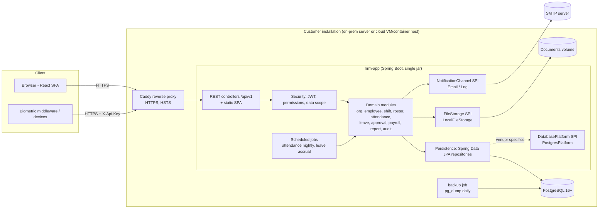

# Design — Premium HRM System (v1 / MVP)

Traces to `specs/requirements.md` (FR/NFR IDs) and `specs/clarifications.md` (CL-xx).

---

## 1. Architecture overview

A **modular monolith**: one Spring Boot application exposing a REST API and serving the built React SPA, backed by one PostgreSQL database per customer installation (CL-A2). The same container image runs on-prem and in the cloud (NFR-001); Caddy terminates HTTPS (NFR-002).



Request flow: Caddy → Spring Security filter chain (correlation id → rate limit → JWT/API-key auth → password-change gate) → controller (`@PreAuthorize("hasAuthority('EMPLOYEE:VIEW')")`) → module service (data-scope checks, business rules, audit) → repositories.

---

## 2. Tech stack

| Layer | Choice | Why |
|---|---|---|
| Language/runtime | Java 21 (LTS) | SRS §7.1; LTS, virtual threads available. |
| Framework | Spring Boot 4.1 (Web MVC, Security, Data JPA, Validation, Mail, Actuator) | SRS §7.1; current supported line. |
| Auth | Spring Security + OAuth2 Resource Server (Nimbus, HS256 JWT) | Standard JWT validation without custom crypto (CL-A4). |
| Persistence | Spring Data JPA / Hibernate 7, Flyway | Repository interfaces = DB-portability seam (NFR-005); versioned migrations (NFR-006). |
| Database | PostgreSQL 16+ (17 in Compose) | CL-A6. |
| PDF | OpenPDF | Table-oriented PDF API, LGPL/MPL licence OK for commercial use. |
| Excel | Apache POI (SXSSF streaming) | De-facto standard, streaming for large exports. |
| API docs | springdoc-openapi | NFR-007. |
| Build | Maven (wrapper) | CL-G1. |
| Backend tests | JUnit 5, AssertJ, Spring Boot Test + MockMvc, zonky embedded-postgres, ArchUnit | Real Postgres without Docker (clarification assumption 8); architecture rules. |
| Frontend | React 19, Vite 8, TypeScript 6.0, Mantine 9 (core, dates, form, notifications), TanStack Query 5, React Router 8, react-i18next, dayjs | SRS §7.1; Mantine gives accessible, responsive enterprise components quickly. TS 6.0 because typescript-eslint does not support TS 7 yet. |
| Frontend tests | Vitest + Testing Library; Playwright (E2E) | NFR-020. |
| Packaging | Docker multi-stage image; Docker Compose (app, postgres, caddy, backup) | CL-F6. |

---

## 3. Repository layout

```
/
├── CLAUDE.md
├── specs/                      # source of truth
├── docs/                       # SRS + install/backup/release guides (NFR-021)
├── backend/
│   ├── pom.xml, mvnw
│   └── src/main/java/com/is2c/hrm/
│       ├── HrmApplication.java
│       ├── common/        # errors (problem+json), paging, money, time, base entities, i18n, web config
│       ├── platform/      # DatabasePlatform SPI + postgres impl, FileStorage SPI + local impl
│       ├── security/      # JWT, users, roles, permissions, data scope, login, refresh tokens
│       ├── admin/         # user & role administration (depends on security + org)
│       ├── audit/
│       ├── org/           # company, branch, department, lookups, settings, holidays
│       ├── employee/      # employee, history, documents, custom fields, numbering
│       ├── shift/         # shifts, rotations, OT policies, schedule resolver
│       ├── roster/
│       ├── attendance/    # sources & adapters, events, daily processing, adjustments, lock
│       ├── leave/
│       ├── approval/      # workflows, transactions, delegation, handler SPI
│       ├── notification/
│       ├── payroll/       # components, slabs, statutory packs, structures, periods, engine, payslips
│       ├── report/        # report definitions, exporters (PDF/Excel/CSV), dashboard
│   └── src/main/resources/
│       ├── application.yml, application-prod.yml
│       ├── messages.properties
│       └── db/migration/postgresql/   # V1__..., vendor folder (NFR-005)
├── frontend/
│   ├── package.json, vite.config.ts
│   └── src/ (app shell, api client, features/<module>/, components/, i18n/)
│   └── e2e/ (Playwright)
└── deploy/
    ├── Dockerfile
    ├── compose.onprem.yml, compose.cloud.yml, Caddyfile*, .env.example
    └── backup/ (backup.sh, restore.sh)
```

Each module package has: `domain/` (entities, repositories), `service/` (business logic), `web/` (controllers + DTOs), optional `api/` (interfaces/DTOs other modules may call). ArchUnit rules (NFR-018): other modules may only depend on a module's `api` (and `domain` entity IDs via service calls are not allowed across modules except `org`/`employee` read APIs); `web` never accessed from other modules; no `nativeQuery` / `JdbcTemplate` outside `platform` (NFR-005).

---

## 4. Module breakdown & requirement mapping

| Module | Responsibilities | Requirements |
|---|---|---|
| common | Problem-details error handling, validation, paging DTO, `Money` helpers, `Clock` bean, base entity (UUID id, version, created/updated by/at, deleted_at), correlation id filter, i18n messages | NFR-008, 009, 010, 013, 014, 015, 016, 017 |
| platform | `DatabasePlatform` (vendor name, migration location, `lockForUpdate` sequence counter), `PostgresDatabasePlatform`; `FileStorage`, `LocalFileStorage` | NFR-005, FR-014, FR-020 |
| security | Users, roles, permissions, login/refresh/logout, lockout, password policy, bootstrap admin, JWT config, `CurrentUser`, `DataScopeService`, rate limit, security headers | FR-001…007, NFR-002, 003, 019 |
| admin | User CRUD, activation, password reset, scope assignment; custom roles & matrix; escalation guards (cannot grant ALL scope without having it, SUPER_ADMIN only by SUPER_ADMIN, no role/permission the actor lacks, non-global admins manage only users confined to companies they fully cover) | FR-003 (reset), FR-004, FR-005, FR-006 |
| audit | `AuditService.record(...)`, audit search/export, append-only enforcement | FR-008 |
| org | Companies, settings, branches, departments (tree), designations, grades, categories, holidays, `DataScopeService`, `OrgDirectory` read API; publishes `CompanyCreatedEvent` that other modules handle to seed per-company defaults | FR-010…013, FR-016, FR-025 |
| employee | Employees, numbering, history, emergency contacts, custom fields, documents, search | FR-014, 015, 017…020 |
| shift | Shifts, rotation patterns & assignments, OT policies, `ScheduleResolver` | FR-030…033 |
| roster | Rosters, entries, bulk assign, copy, conflict detection, publish/lock, revisions | FR-035…040 |
| attendance | Sources & API keys, adapters, events ingestion/import, `AttendanceCalculator` (pure), `AttendanceProcessor`, adjustments, lock check, exceptions, OT approval | FR-045…056 |
| leave | Leave types, balances, accrual/CF/expiry jobs, applications, approval handler, calendar | FR-060…066 |
| approval | Workflow definitions, resolution, transactions, inbox, delegation, `ApprovalHandler` SPI | FR-070…073 |
| notification | `NotificationService`, `NotificationChannel` SPI, email & log channels, after-commit dispatch | FR-074 |
| payroll | Components, slab tables, `StatutoryPack` SPI + `SriLankaStatutoryPack`, salary structures, periods, one-time items, `PayrollEngine` (pure), `PayrollProcessor`, approval handler, finalization, payslip PDF, register exports | FR-080…089 |
| report | `TabularReport` model, report providers, `PdfExporter`, `ExcelExporter`, `CsvExporter`, dashboard KPIs | FR-095, 096 |
| selfservice | `/api/v1/me/**` delegating to module services with the linked employee | FR-100 |

---

## 5. Data model

All tables: `id UUID PK` (app-generated time-ordered UUID), and for mutable master/config tables `version BIGINT`, `created_at/created_by/updated_at/updated_by`, `deleted_at` (soft delete where NFR-014 applies). Timestamps `TIMESTAMPTZ` stored UTC; business dates `DATE`; shift times `TIME`. Money `NUMERIC(15,2)`; rates `NUMERIC(9,4)`; days `NUMERIC(6,2)`. Text-JSON (`audit` before/after, approval snapshot) stored as `TEXT` for portability.

### 5.1 Security & audit
- `app_user` (username UNIQUE lower, email, display_name, password_hash, employee_id FK UNIQUE NULL, active, must_change_password, failed_attempts, locked_until, scope_type, last_login_at)
- `user_scope_item` (user_id, item_type COMPANY|BRANCH|DEPARTMENT, item_id) — PK(user_id,item_type,item_id)
- `role` (code UNIQUE, name, system BOOL, description) ; `role_permission` (role_id, permission VARCHAR) ; `user_role` (user_id, role_id)
- `refresh_token` (user_id, token_hash UNIQUE, expires_at, revoked_at, replaced_by)
- `audit_log` (occurred_at, user_id, username, on_behalf_of, action, entity_type, entity_id, company_id, before_json, after_json, reason, ip, correlation_id) — **append-only** (Postgres trigger raising on UPDATE/DELETE, in vendor migration).

### 5.2 Organization
- `company` (code UNIQUE, legal_name, registration_no, address, phone, email, currency, epf_employer_no, etf_no, statutory_pack, time_zone)
- `company_settings` (company_id UNIQUE, weekly_off_days VARCHAR (CSV of DayOfWeek), employee_number_format, payroll_start_day, absent_as_no_pay, no_pay_divisor, punch_window_before_min, punch_window_after_min, week_start_day)
- `branch` (company_id, code, name, address, phone) UNIQUE(company_id, code) where not deleted
- `department` (company_id, parent_id, branch_id NULL, code, name, cost_center_code, manager_employee_id)
- `designation`, `grade` (rank), `employment_category` (ot_eligible) — each (company_id, code UNIQUE per company, name)
- `holiday` (company_id, holiday_date, name, type, all_branches) ; `holiday_branch` (holiday_id, branch_id)
- `number_sequence` (company_id, sequence_key, next_value) — UNIQUE(company_id, sequence_key)

### 5.3 Employee
- `employee` (company_id, branch_id, department_id, designation_id, grade_id, category_id, employee_number, title, first_name, last_name, preferred_name, nic, date_of_birth, gender, marital_status, nationality, personal_email, mobile, address, join_date, probation_end_date, confirmation_date, contract_end_date, exit_date, exit_reason, reporting_manager_id, default_shift_id, weekly_off_days, badge_id, status) UNIQUE(company_id, employee_number), UNIQUE(company_id, badge_id), UNIQUE(company_id, nic)
- `emergency_contact` (employee_id, name, relationship, phone, sort_order)
- `employment_history` (employee_id, effective_date, event_type JOINED|TRANSFER|PROMOTION|STATUS_CHANGE|CHANGE, changes_json, reason, recorded_by, recorded_at)
- `custom_field_def` (company_id, field_key, label, field_type, options_csv, required, active, display_order)
- `custom_field_value` (employee_id, field_def_id, value_text) PK(employee_id, field_def_id)
- `employee_document` (employee_id, doc_type, title, file_name, content_type, size_bytes, storage_key, expiry_date, uploaded_by, uploaded_at, deleted_at)

### 5.4 Shift & roster
- `ot_policy` (company_id, name, min_ot_minutes, rounding_minutes, allow_pre_shift_ot, max_ot_minutes, requires_approval)
- `shift` (company_id, code, name, shift_type, color, s1_start, s1_end, s2_start, s2_end, flex_earliest_start, flex_latest_end, required_minutes, late_grace_min, early_grace_min, break_mode, break_minutes, break_threshold_min, half_day_threshold_min, ot_policy_id, window_before_min, window_after_min, active)
- `rotation_pattern` (company_id, name) ; `rotation_pattern_day` (pattern_id, day_index, shift_id NULL=OFF)
- `rotation_assignment` (employee_id, pattern_id, start_date, end_date)
- `roster` (company_id, department_id, name, period_type, start_date, end_date, status DRAFT|PUBLISHED|LOCKED, revision)
- `roster_entry` (roster_id, employee_id, work_date, shift_id NULL, is_off) UNIQUE(roster_id, employee_id, work_date)
- `roster_revision` (roster_id, revision, employee_id, work_date, old_value, new_value, reason, changed_by, changed_at)

### 5.5 Attendance
- `attendance_source` (company_id, name, adapter_type GENERIC_JSON|CSV, api_key_hash, api_key_prefix, active)
- `attendance_event` (source_id, company_id, external_id, device_id, employee_identifier, employee_id NULL, event_time TIMESTAMPTZ, direction, status MATCHED|UNMATCHED, received_at) UNIQUE(source_id, external_id); INDEX(employee_id, event_time)
- `attendance_daily` (employee_id, company_id, work_date, shift_id, day_type, status, first_in, last_out, scheduled_min, worked_min, late_min, early_min, short_min, ot_workday_min, ot_offday_min, ot_holiday_min, extra_min, ot_requires_approval, ot_approved, ot_rejected, absent_fraction NUMERIC(3,2), leave_fraction, leave_paid, leave_request_id, manual BOOL, exceptions VARCHAR (CSV flags), processed_at) UNIQUE(employee_id, work_date)
- `attendance_adjustment` (employee_id, work_date, adj_type CREATE|EDIT, new_in, new_out, before_in, before_out, before_status, reason, status PENDING|APPLIED|REJECTED|CANCELLED, override_lock, approval_id, requested_by, requested_at, decided_at)

### 5.6 Leave
- `leave_type` (company_id, code, name, paid, annual_days, accrual_method, pro_rata, cf_max_days, cf_expiry_months, allow_half_day, allow_negative, unlimited, count_weekly_off, count_holiday, attachment_above_days, eligible_category_ids CSV, color, active)
- `leave_balance` (employee_id, leave_type_id, leave_year, opening, entitled, carried_forward, adjustment, taken, pending, expired, cf_used, last_accrual_month) UNIQUE(employee_id, leave_type_id, leave_year)
- `leave_balance_txn` (balance_id, txn_type OPENING|ACCRUAL|CARRY_FORWARD|EXPIRY|ADJUSTMENT|TAKEN|PENDING|RELEASE, days, reference, reason, created_by, created_at) — ledger for idempotency & audit
- `leave_request` (employee_id, company_id, leave_type_id, from_date, to_date, half_day_part, days, reason, status PENDING|APPROVED|REJECTED|CANCELLED, approval_id, applied_by, applied_at, decided_at, cancel_reason)
- `leave_request_day` (request_id, leave_date, fraction, part) — for attendance & payroll lookups
- `leave_attachment` (request_id, file_name, content_type, size_bytes, storage_key)

### 5.7 Approval
- `approval_workflow` (company_id, branch_id NULL, department_id NULL, txn_type, enabled) UNIQUE(txn_type, company_id, branch_id, department_id)
- `approval_workflow_level` (workflow_id, level_no, approver_type, role_code, user_id)
- `approval_transaction` (txn_type, reference_id, company_id, requester_user_id, requester_employee_id, status, current_level, levels_snapshot TEXT, summary, submitted_at, completed_at)
- `approval_action` (transaction_id, level_no, action SUBMIT|APPROVE|REJECT|CANCEL|AUTO|FALLBACK, user_id, on_behalf_of, comment, acted_at)
- `approval_delegation` (delegator_user_id, delegate_user_id, from_date, to_date, active)

### 5.8 Payroll
- `slab_table` (company_id, code, name, statutory) ; `slab_row` (table_id, row_no, lower_bound, upper_bound NULL, rate_percent)
- `payroll_component` (company_id, code, name, kind, frequency, assignment, calc_type, sequence, bases CSV, basis_ref, rate_percent, unit_metric, unit_rate_mode FIXED|BASIS, unit_fixed_amount, divisor, multiplier, slab_table_id, prorate, show_on_payslip, statutory, system, active)
- `salary_structure` (employee_id, effective_from, effective_to NULL, basic_salary)
- `salary_structure_line` (structure_id, component_id, amount, rate_override, multiplier_override, excluded)
- `payroll_period` (company_id, year, month, start_date, end_date, status, stale, approval_id, processed_at, finalized_at, finalized_by) UNIQUE(company_id, year, month)
- `payroll_one_time_item` (period_id, employee_id, component_id, amount, note)
- `payroll_result` (period_id, employee_id, employee_number, employee_name, department_name, designation_name, gross, deductions, net, employer_contributions, worked_days, no_pay_days, ot_hours, payslip_no, exceptions, locked) UNIQUE(period_id, employee_id)
- `payroll_result_line` (result_id, component_code, component_name, kind, units, rate, amount, show_on_payslip, sort_order, locked)
- `payroll_exception` (period_id, employee_id, code, message, blocking)
- Postgres trigger: reject UPDATE/DELETE on `payroll_result`, `payroll_result_line` rows where `locked = true` (vendor migration).

---

## 6. Security design

### 6.1 Authentication
- `POST /api/v1/auth/login` → `{accessToken, refreshToken, expiresIn, user}`; access token = HS256 JWT (`sub`=user id, `name`, `perms` not included — permissions loaded per request from a short-TTL cache keyed by user id so role changes apply within 60 s). Secret from `HRM_JWT_SECRET` (≥ 32 bytes; dev profile generates a random one).
- Refresh tokens: 256-bit random, base64url, SHA-256 hash stored; rotation + reuse detection (FR-002).
- Lockout counters on `app_user` (FR-001). Login rate limit per IP: in-memory token bucket (single instance per customer).
- Device ingestion: `X-Api-Key` header → `ApiKeyAuthenticationFilter` on `/api/v1/integrations/attendance/**` only; key format `hrm_<prefix>_<secret>`, lookup by prefix, constant-time hash compare.

### 6.2 Authorization
- Permission strings `MODULE:ACTION` granted as Spring authorities; controllers annotate `@PreAuthorize`.
- Default role matrix (seeded, editable except SUPER_ADMIN):

| Role | Permissions |
|---|---|
| SUPER_ADMIN | all |
| COMPANY_ADMIN | ORG:*, EMPLOYEE:*, ATTENDANCE:*, SHIFT:*, ROSTER:*, LEAVE:*, APPROVAL:*, REPORT:VIEW/EXPORT, AUDIT:VIEW, ADMIN:VIEW/ADD/EDIT/DELETE/CONFIGURE |
| HR_MANAGER | ORG:VIEW, EMPLOYEE:*, ATTENDANCE:*, SHIFT:VIEW/ADD/EDIT, ROSTER:VIEW/ADD/EDIT/APPROVE, LEAVE:*, APPROVAL:VIEW/APPROVE, PAYROLL:VIEW/APPROVE/EXPORT, REPORT:VIEW/EXPORT |
| PAYROLL_OFFICER | ORG:VIEW, EMPLOYEE:VIEW, ATTENDANCE:VIEW, LEAVE:VIEW, PAYROLL:VIEW/ADD/EDIT/DELETE/EXPORT/CONFIGURE, REPORT:VIEW/EXPORT |
| BRANCH_MANAGER | ORG:VIEW, EMPLOYEE:VIEW, ATTENDANCE:VIEW/APPROVE, SHIFT:VIEW, ROSTER:VIEW/APPROVE, LEAVE:VIEW/APPROVE, APPROVAL:VIEW, REPORT:VIEW/EXPORT |
| DEPARTMENT_MANAGER | ORG:VIEW, EMPLOYEE:VIEW, ATTENDANCE:VIEW/APPROVE, SHIFT:VIEW, ROSTER:VIEW/ADD/EDIT/APPROVE, LEAVE:VIEW/APPROVE, APPROVAL:VIEW, REPORT:VIEW |
| SUPERVISOR | ORG:VIEW, EMPLOYEE:VIEW, ATTENDANCE:VIEW, SHIFT:VIEW, ROSTER:VIEW/ADD/EDIT, LEAVE:VIEW |
| EMPLOYEE | (none — self-service endpoints need only authentication + linked employee) |
| AUDITOR | VIEW and EXPORT on ORG, EMPLOYEE, ATTENDANCE, SHIFT, ROSTER, LEAVE, APPROVAL, REPORT, AUDIT |

`X:*` = all seven actions. "Approve" of workflow items is governed by workflow eligibility (FR-071), not by `APPROVE` permissions; `APPROVE` gates non-workflow approvals (roster publish, OT approval, payroll finalize).

### 6.3 Data scope (FR-006)
Implemented by `org.service.DataScopeService` (scope is an org-structure concern); the employee module supplies employee placements through `org.api.EmployeePlacementLookup`, and modules that reference org records implement `org.api.OrgReferenceChecker` (deletion guards) — avoiding module cycles. Company-level **reads** require `coversCompany` (ALL, company in scope, or the company of a scoped branch/department/own employee); company-level **writes** require `coversWholeCompany` (ALL or company explicitly in a COMPANY scope).
`DataScopeService.current()` returns an `EmployeeScope` (ALL | sets of company ids, branch ids, department ids expanded with descendants | own employee id). Repository queries take it as a JPA `Specification<Employee>` (or the equivalent JPQL predicate on `employee.companyId/branchId/departmentId/id`). `assertInScope(employee)` throws `NotFoundException` (404). Company-level resources (settings, shifts, leave types…) check `scope.coversCompany(companyId)` — branch/department-scoped users "cover" their branch's company for read-only lookups.

### 6.4 Other
- Security headers & CSP via Spring Security; CORS origins from `HRM_CORS_ORIGINS`.
- `mustChangePassword` gate filter (FR-003).
- Uploaded files: size limit, content sniffing via magic bytes (PDF `%PDF`, PNG, JPEG, DOCX zip + `[Content_Types].xml`), stored under random key outside web root, served with `Content-Disposition: attachment`.

---

## 7. Key algorithms

### 7.1 Schedule resolution (FR-033) — `ScheduleResolver`
Batch API `resolve(employeeIds, from, to) → Map<(emp,date), DaySchedule>` loads roster entries (published/locked), rotation assignments, employees' default shift/weekly-off, company settings and holidays once per batch. `DaySchedule {date, dayType, shift?, sessions: List<[LocalDateTime start, end]>, holidayName?}`. Sessions are absolute: cross-midnight end = date+1.

### 7.2 Daily attendance calculation (FR-048) — `AttendanceCalculator` (pure function)
Input: `DaySchedule` for D-1, D, D+1, events in [D-1 00:00, D+2 12:00], approved leave fraction/part/paid for D, applied adjustment for D (if any), OT policy, OT eligibility, half-day threshold, company punch window defaults.
1. **Window**: if shift on D: `[firstSessionStart − before, lastSessionEnd + after]`; else `[D 00:00, D+1 00:00)`. An event lying in two candidate windows (D's and a neighbour's) is assigned to the date whose shift boundary (start for IN-side, end for OUT-side; nearest of start/end for UNKNOWN) is nearest; windows of days with a shift take precedence over days without a shift. (Documented limitation: an off-day punch inside the after-window of a previous night shift is attributed to the night shift; correct via manual edit.)
2. **Override**: if an applied adjustment exists, punches = single pair (new_in, new_out).
3. **Pairing**: sort; if any direction known → IN opens a pair, OUT closes the open pair (OUT without open pair ignored as duplicate; consecutive INs keep the first); else alternate. Unclosed pair → `INCOMPLETE`.
4. **Worked** = Σ pair durations; break: FIXED → subtract `breakMinutes` if gross ≥ threshold; PUNCHED → no subtraction.
5. **Sessions** (non-flex): for each session, segment = punches whose pair overlaps the session ± window (split at midpoint between sessions); late/early per FR-048 rules; session with no punches contributes its full length to short.
   Half-day leave: MORNING → ignore late and first half; AFTERNOON → ignore early departure; scheduled minutes halved.
6. **Scheduled** = Σ session lengths − fixed break (flex: required minutes). **Short** = max(0, scheduled − worked).
7. **Raw OT**: WORKDAY: post = max(0, lastOut − lastSessionEnd) (+ pre = max(0, firstSessionStart − firstIn) if allowed); flex: max(0, worked − required). WEEKLY_OFF/HOLIDAY: worked. Then if not OT-eligible → extra = raw, OT = 0; else OT = raw < min ? 0 : floor(raw/unit)·unit, capped by max. Bucket by day type.
8. **Status**: full-day leave → ON_LEAVE (absent 0); HOLIDAY/WEEKLY_OFF without punches → HOLIDAY/WEEKLY_OFF; WORKDAY without punches → ABSENT (absent 1, or 0.5 when half-day leave); incomplete → INCOMPLETE (absent 0); worked < half-day threshold → HALF_DAY (absent 0.5); half-day leave with work → HALF_DAY_LEAVE; else PRESENT. No shift on WORKDAY → UNSCHEDULED (absent 0).
9. **Exceptions** flags: INCOMPLETE, ABSENT, LATE, EARLY, UNSCHEDULED, OT_PENDING.
10. **Clarified rules (implemented in T-018)**: punch ownership distance is 0 inside a shift span, else minutes to the nearest span boundary (ties → earlier date); short minutes are 0 on ABSENT/HALF_DAY days (the absent fraction already penalises them); days without a shift (weekly-off/holiday by default schedule) use the employee's default-shift OT policy as fallback; UNSCHEDULED workdays earn no OT.

`AttendanceProcessor` loads inputs in batch per company/date range, calls the calculator, upserts `attendance_daily`, checks locks (FR-053) and marks DRAFT payroll periods stale.

### 7.3 Payroll engine (FR-085) — `PayrollEngine` (pure function)
Input: `EmployeePayInput {basic, structureLines, oneTimeItems, metrics, prorationFactor}`, ordered `List<ComponentDef>`, slab tables. For each component in sequence:
- applicability: AUTOMATIC unless line.excluded; PER_EMPLOYEE only if in structure (RECURRING) or one-time items (ONE_TIME).
- FIXED: Σ amounts (BASIC = basic salary); × proration if `prorate`.
- PERCENT_OF: rate (line override or component) % × basis.
- PER_UNIT: units = metric; unit rate = fixed or basis/divisor×multiplier (overrides from line).
- SLAB: progressive: Σ over rows of max(0, min(value, upper) − lower) × rate%.
- amount = max(0, round2(x)); add to totals by kind; for each base membership: base += (EARNING ? +amount : DEDUCTION ? −amount : 0); GROSS = Σ earnings so far.
Output: lines + totals. `PayrollProcessor` gathers inputs in batch, runs engine per employee (parallel-safe, pure), persists results.

### 7.4 Period dates (FR-084)
`startDay = 1` → [1st, last day of month]; else [startDay of previous month, startDay−1 of month].

### 7.5 Leave days (FR-063)
For each date in range: dayType from `ScheduleResolver`; count if WORKDAY, or WEEKLY_OFF with `countWeeklyOff`, or HOLIDAY with `countHoliday`; half day → 0.5.

### 7.6 Approval resolution (FR-070/071)
Workflow candidates for (type, company): filter enabled; choose department match (employee's department or ancestor, nearest first) > branch match > company-level. Snapshot levels JSON on submit so later config edits don't affect in-flight items.

---

## 8. API contracts

Base `/api/v1`, JSON, `Authorization: Bearer <jwt>`. Lists: `?page=0&size=20&sort=field,asc` → `{content:[], page, size, totalElements, totalPages}`. Errors (NFR-009):
```json
{"type":"about:blank","title":"Validation failed","status":422,"code":"VALIDATION_FAILED",
 "detail":"…","correlationId":"…","errors":[{"field":"lastName","message":"must not be blank"}]}
```
Codes include `VALIDATION_FAILED`, `NOT_FOUND`, `FORBIDDEN`, `CONFLICT`, `OPTIMISTIC_LOCK`, `ATTENDANCE_LOCKED`, `PAYROLL_LOCKED`, `PASSWORD_CHANGE_REQUIRED`, `ACCOUNT_LOCKED`, `INVALID_STATE`.

| Area | Endpoints |
|---|---|
| Auth | `POST /auth/login`, `POST /auth/refresh`, `POST /auth/logout`, `GET /auth/me`, `POST /auth/change-password` |
| Admin | `GET/POST /admin/users`, `GET/PUT /admin/users/{id}`, `POST /admin/users/{id}/reset-password`, `POST /admin/users/{id}/deactivate`; `GET/POST /admin/roles`, `GET/PUT/DELETE /admin/roles/{id}`, `GET /admin/permissions` |
| Audit | `GET /audit?from&to&userId&entityType&entityId&action`, `GET /audit/export?format=pdf|xlsx|csv&…` |
| Org | `GET/POST /companies`, `GET/PUT /companies/{id}`, `GET/PUT /companies/{id}/settings`; `GET/POST /companies/{cid}/branches`, `PUT/DELETE /branches/{id}`; `GET /companies/{cid}/departments/tree`, `POST /companies/{cid}/departments`, `PUT/DELETE /departments/{id}`; same pattern for `designations`, `grades`, `employment-categories`; `GET/POST /companies/{cid}/holidays?year=`, `PUT/DELETE /holidays/{id}`, `POST /companies/{cid}/holidays/copy {fromYear,toYear}` |
| Employee | `GET /employees?q&companyId&branchId&departmentId&designationId&categoryId&status`, `POST /employees`, `GET/PUT/DELETE /employees/{id}`, `POST /employees/{id}/status {status, effectiveDate, exitDate, reason}`, `GET /employees/{id}/history`, `GET/POST /employees/{id}/documents` (multipart), `GET /employees/{id}/documents/{docId}/content`, `DELETE /employees/{id}/documents/{docId}`; `GET/POST /companies/{cid}/custom-fields`, `PUT /custom-fields/{id}` |
| Shift | `GET/POST /companies/{cid}/shifts`, `GET/PUT /shifts/{id}`, `POST /shifts/{id}/deactivate`; `…/ot-policies`; `…/rotation-patterns`, `POST /rotation-patterns/{id}/assignments`, `GET /employees/{id}/rotation-assignments`, `DELETE /rotation-assignments/{id}`; `GET /schedules?companyId&departmentId&employeeId&from&to` |
| Roster | `GET/POST /rosters`, `GET /rosters/{id}` (with entries), `PUT /rosters/{id}/entries` (`[{employeeId,date,shiftId|null,off}]`, `reason` when published), `POST /rosters/{id}/bulk-assign {employeeIds, from, to, weekdays?, shiftId|off}`, `POST /rosters/{id}/copy-from/{sourceId}`, `POST /rosters/{id}/validate`, `POST /rosters/{id}/publish`, `POST /rosters/{id}/lock`, `POST /rosters/{id}/unlock {reason}`, `GET /rosters/{id}/revisions` |
| Attendance | `POST /integrations/attendance/events` (API key); `GET/POST /companies/{cid}/attendance-sources`, `POST /attendance-sources/{id}/regenerate-key`, `POST /attendance-sources/{id}/deactivate`; `POST /attendance/import?companyId` (multipart CSV); `POST /attendance/rematch?companyId`; `POST /attendance/process {companyId, employeeIds?, from, to}`; `GET /attendance/daily?companyId&from&to&departmentId&employeeId&status`; `GET /attendance/daily/{employeeId}/{date}` (with events & adjustments); `POST /attendance/adjustments {employeeId, date, in, out, reason, overrideLock}`; `GET /attendance/exceptions?companyId&from&to&type`; `GET /attendance/unmatched-events?companyId`; `POST /attendance/ot/approve|reject {dailyIds[]}` |
| Leave | `GET/POST /companies/{cid}/leave-types`, `PUT /leave-types/{id}`; `GET /leave/balances?employeeId&year`, `POST /leave/balances/opening`, `POST /leave/balances/adjust`; `POST /leave/jobs/accrual|year-end|expiry`; `GET /leave/requests?…`, `POST /leave/requests` (multipart: json part + files), `GET /leave/requests/{id}`, `POST /leave/requests/{id}/cancel {reason}`, `GET /leave/requests/{id}/attachments/{aid}`; `GET /leave/calendar?companyId&from&to&includePending` |
| Approval | `GET/POST /approval/workflows`, `PUT/DELETE /approval/workflows/{id}`; `GET /approval/inbox`, `GET /approval/my-requests`, `GET /approval/transactions/{id}`, `POST /approval/transactions/{id}/approve|reject|cancel {comment}`; `GET/POST /approval/delegations`, `DELETE /approval/delegations/{id}` |
| Payroll | `GET/POST /companies/{cid}/payroll-components`, `PUT /payroll-components/{id}`; `GET/POST /companies/{cid}/slab-tables`, `PUT /slab-tables/{id}`; `GET /companies/{cid}/statutory` (statutory components + tables); `GET /employees/{id}/salary-structures`, `POST /employees/{id}/salary-structures`; `GET/POST /payroll/periods`, `GET /payroll/periods/{id}`, `POST /payroll/periods/{id}/process|submit|send-back|finalize`; `GET /payroll/periods/{id}/results?…`, `GET /payroll/periods/{id}/results/{employeeId}`, `GET /payroll/periods/{id}/exceptions`; `GET/POST /payroll/periods/{id}/items`, `PUT/DELETE /payroll/items/{id}`; `GET /payroll/periods/{id}/payslips/{employeeId}.pdf`, `GET /payroll/periods/{id}/payslips.pdf?departmentId`, `POST /payroll/periods/{id}/payslips/email {employeeIds?}`; `GET /payroll/periods/{id}/register?format=xlsx|csv|pdf`, `GET /payroll/periods/{id}/department-summary?format=xlsx|pdf` |
| Reports | `GET /reports` (catalog), `GET /reports/{key}?params…` (JSON table), `GET /reports/{key}/export?format=pdf|xlsx|csv&params…`; `GET /dashboard?companyId` |
| Self-service | `GET /me/profile`, `GET /me/documents`, `GET /me/documents/{id}/content`, `GET /me/attendance?from&to`, `GET /me/schedule?from&to`, `GET /me/leave/balances?year`, `GET /me/leave/requests`, `POST /me/leave/requests`, `POST /me/leave/requests/{id}/cancel`, `GET /me/payslips`, `GET /me/payslips/{periodId}.pdf` |

---

## 9. Cross-cutting strategies

- **Error handling**: domain exceptions (`ValidationException`, `NotFoundException`, `ConflictException`, `InvalidStateException`, `LockedException`) mapped by `@RestControllerAdvice` to problem+json; Bean Validation errors → 422 with field list; unexpected → 500 generic body, full log with correlation id.
- **Audit**: explicit `auditService.record(AuditEntry)` calls in services within the same transaction (audit row commits/rolls back with the change). Before/after snapshots are DTO maps serialized to JSON.
- **Logging**: SLF4J/Logback; `CorrelationIdFilter` puts `correlationId`, `userId` in MDC; prod profile uses Logback structured JSON (Boot structured logging `ecs`).
- **Configuration**: `application.yml` with `${HRM_*}` env placeholders; profiles `dev`, `test`, `prod`; `HrmProperties` typed config (`hrm.edition`, `hrm.db.vendor`, `hrm.jwt.*`, `hrm.storage.path`, `hrm.mail.*`, `hrm.cors.origins`, `hrm.api-docs`).
- **Time**: injected `java.time.Clock` (tests fix it); attendance in company time zone.
- **Transactions**: service-layer `@Transactional`; notifications via `@TransactionalEventListener(AFTER_COMMIT)` + async executor.
- **Scheduling**: `@Scheduled` cron (configurable): attendance nightly 01:00, leave accrual 00:30 on day 1, year-end/expiry 00:45 daily (idempotent checks). Single instance per customer → no distributed lock.
- **Frontend**: Mantine `AppShell` with role-aware navigation from `/auth/me` permissions; feature folders; `api/client.ts` fetch wrapper with token refresh & problem+json parsing; TanStack Query for caching; generic `DataTable` (server pagination), `CrudDrawer` forms with Mantine form validation mirroring server rules; i18n keys in `src/i18n/en.json`. Built assets copied into backend `static/` during Maven `prepare-package` (frontend-maven-plugin not used; Dockerfile builds frontend stage then backend stage) — dev uses Vite proxy to `localhost:8080`.

---

## 10. Testing strategy

| Level | Scope | Tooling |
|---|---|---|
| Unit | Pure engines: `AttendanceCalculator`, `ScheduleResolver` logic, `PayrollEngine`, slab calc, leave-day counter, period-date calc, number formatter, password policy, CSV parsing | JUnit 5 + AssertJ, no Spring |
| Integration (API) | Each FR's acceptance criteria via MockMvc against the full app + embedded PostgreSQL 17 (zonky); one shared DB per JVM, tables truncated between tests via `DbCleaner`; fixed `Clock`; `TestData` builders | Spring Boot Test, MockMvc |
| DB-level | Audit append-only trigger, locked payroll trigger, unique constraints | integration tests issuing raw JDBC in test code |
| Architecture | Module boundaries, no native SQL outside `platform`, controllers secured | ArchUnit |
| Performance | Payroll processing 1,000 employees × 1 month < 60 s (tagged `perf`, run in `mvn verify -Pperf`) | JUnit |
| Frontend unit | API client (refresh, errors), permission-based nav, key forms (leave apply validation, login) | Vitest + Testing Library |
| E2E smoke | Login → create employee → apply/approve leave → process attendance → process/approve/finalize payroll → download payslip | Playwright against `spring-boot:test-run` (embedded PG) + Vite preview |

Test naming references requirement IDs (e.g. `@DisplayName("FR-063 rejects overlapping leave")`) so the traceability matrix can be generated by grep.

---

## 11. Key design decisions

| # | Decision | Alternatives considered | Why rejected |
|---|---|---|---|
| D1 | Modular monolith | Microservices | One deployable per customer on-prem; no team/scale need for distribution. |
| D2 | Deployment-per-customer isolation (CL-A2) | Shared schema `tenant_id`; schema-per-tenant | Same code path both editions, strongest isolation; multi-tenancy deferred. |
| D3 | JPA repositories + vendor migration folders + `DatabasePlatform` SPI (CL-A6) | jOOQ; MyBatis; plain JDBC | JPA keeps SQL vendor-neutral by default; others push SQL into domain code. |
| D4 | Statutory rules as ordinary components/slab tables seeded by `StatutoryPack` (CL-B1) | Dedicated statutory engine with hard-coded formulas; scripting (SpEL/JS) formulas | Hard-coding violates §14; scripting is unsafe & hard to validate. Calculation types cover SL EPF/ETF/APIT. |
| D5 | Pure calculation engines (attendance, payroll) separated from persistence | Logic inside JPA services | Deterministic, fast unit tests for the riskiest logic. |
| D6 | Opaque rotating refresh tokens + short JWT | Server sessions; long-lived JWT | Stateless API for SPA and future integrations; revocation via refresh store. |
| D7 | Embedded PostgreSQL for tests | Testcontainers; H2 | Docker not guaranteed; H2 differs from Postgres (triggers, types). |
| D8 | Spring Boot serves SPA | Separate nginx container for SPA | Single artifact simplifies on-prem install (`java -jar` possible). |
| D9 | UUID keys (app-generated, time-ordered) | DB identity/sequences | Portable across vendors, safe to expose, no round-trip. |
| D10 | Approval engine with handler SPI + level snapshot | Per-module bespoke approval logic | One engine for leave/attendance/payroll (§4.7); snapshot prevents config drift on in-flight items. |
| D11 | Text JSON columns for audit/snapshots | `jsonb` | Portability (NFR-005); not queried by content. |
